# Part 3, step 2 (clean) – differential expression, grouping, enrichment (tutorial 3-4 to 3-7)
Run each cell with **Shift+Enter**; plots appear below the cell.

Comparisons are done **within one cohort only** (README):

| Name | Cohort | Case vs control | Covariate |
|---|---|---|---|
| `aging` | Aging | 21 mo vs 3 mo | sex |
| `diet` | Dietary Intervention | aDR vs AL | – |
| `ymp` | Young Plasma Injection | YMP vs PBS | – |

Same analysis as `03_part3_step2.ipynb`, but **all samples flagged as bad in step 1 / 1b are excluded**:

| Sample | Group | Why |
|---|---|---|
| SRR21355389 | aging 21mo | blood contamination (hemoglobin, neutrophil genes); dominates PC1 of the aging cohort |
| SRR23914572 | AL (mouse 572) | outlier of the diet cohort; alone on PC1, AL samples only cluster without it |

This leaves 25 samples: aging 3mo 4 / 18mo 4 / 21mo 3, AL 3 vs aDR 5, PBS 3 vs YMP 3. Results are written to `part3_output/clean/`, so the files of the first step 2 run are kept.


```R
options(jupyter.display_mimetypes = c("text/plain", "text/html"))
```

## Setup


```R
library(tidyverse)
library(ggrepel)
library(pbapply)
library(DESeq2)

options(repr.plot.width = 8, repr.plot.height = 5.5)   # plot size in the notebook
# White plot background (otherwise VS Code dark theme shows through)
setHook("before.plot.new", function() par(bg = "white"))
theme_update(plot.background = element_rect(fill = "white", colour = NA))

base <- "~/Documents/claude/Claude/Systems Genomics/RNAseq_aging/for_teammates"
out  <- "~/Documents/claude/Claude/Systems Genomics/part3_output/clean"
dir.create(out, recursive = TRUE, showWarnings = FALSE)

read_table <- function(f) as.matrix(read.csv(file.path(base, f), row.names = 1, check.names = FALSE))
expr   <- read_table("rsem_tpm.csv.gz")               # TPM
counts <- read_table("rsem_expected_counts.csv.gz")   # estimated reads (for DESeq2)
efflen <- read_table("rsem_effective_length.csv.gz")  # gene length per sample (for DESeq2)

meta <- read.csv(file.path(base, "samples.csv"))
rownames(meta) <- meta$SRR

# Samples flagged as bad in step 1 / 1b
excluded <- c("SRR21355389",   # aging 21mo, blood contamination
              "SRR23914572")   # AL 572, outlier of the diet cohort
meta <- meta[!meta$SRR %in% excluded, ]
expr   <- expr[, meta$SRR]
counts <- counts[, meta$SRR]
efflen <- efflen[, meta$SRR]

meta_genes <- read.csv(file.path(base, "genes_M39.csv"))
meta_genes <- data.frame(gene_id = rownames(expr)) %>%
  left_join(meta_genes, by = "gene_id") %>%
  mutate(ensembl = sub("\\..*", "", gene_id))          # Ensembl id without version (.6)
sym <- setNames(meta_genes$symbol, meta_genes$gene_id)

table(meta$group)
```


    
           aDR aging 18mo aging 21mo  aging 3mo         AL        PBS        YMP 
             5          4          3          4          3          3          3 


```R
# The three comparisons
comparisons <- list(
  aging = list(cohort = "Aging",                  ctrl = "aging 3mo", case = "aging 21mo", covar = "sex"),
  diet  = list(cohort = "Dietary Intervention",   ctrl = "AL",        case = "aDR",        covar = NULL),
  ymp   = list(cohort = "Young Plasma Injection", ctrl = "PBS",       case = "YMP",        covar = NULL)
)

# Samples of one comparison
get_samples <- function(cmp) meta[meta$cohort == cmp$cohort & meta$group %in% c(cmp$ctrl, cmp$case), ]

# DE thresholds used throughout
padj_cut <- 0.1         # adjusted p-value
lfc_cut  <- log2(1.5)   # at least 1.5-fold change

sapply(comparisons, function(cmp) table(get_samples(cmp)$group))
```


<table class="dataframe">
<caption>A matrix: 2 × 3 of type int</caption>
<thead>
	<tr><th></th><th scope=col>aging</th><th scope=col>diet</th><th scope=col>ymp</th></tr>
</thead>
<tbody>
	<tr><th scope=row>aging 21mo</th><td>3</td><td>5</td><td>3</td></tr>
	<tr><th scope=row>aging 3mo</th><td>4</td><td>3</td><td>3</td></tr>
</tbody>
</table>


## 3-4 Differential expression analysis
### ANCOVA on one gene
Full model `y ~ group + sex` vs null model `y ~ sex`; `anova` tests whether adding the group improves the fit. Example: *C4b*, a complement gene known to increase in the aging brain.


```R
m <- get_samples(comparisons$aging)
g <- meta_genes$gene_id[which(meta_genes$symbol == "C4b")]

dat <- data.frame(y = log1p(expr[g, m$SRR]), group = m$group, sex = m$sex)
m1 <- lm(y ~ group + sex, data = dat)
m0 <- lm(y ~ sex, data = dat)
anova(m1, m0)$Pr[2]

options(repr.plot.width = 5, repr.plot.height = 4)
ggplot(dat, aes(group, y, colour = sex)) +
  geom_point(size = 3, position = position_jitter(width = 0.1, seed = 1)) +
  labs(y = "log(TPM + 1)", title = "C4b") +
  theme_bw()
```


0.00429067308326776


    
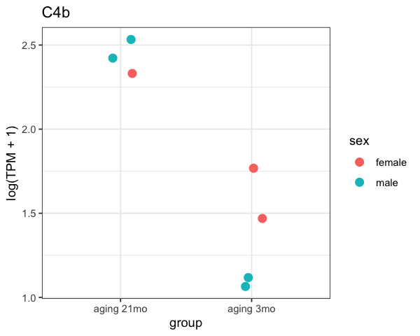
    


### ANCOVA on all expressed genes
The tutorial's `DE_test`, adapted to a case-control comparison: the fold change is case vs control (so it can be negative on the log scale), and p-values are corrected with Benjamini–Hochberg (BH; less strict than Bonferroni, which is too conservative with 3–5 samples per group). Genes are filtered within the samples of each comparison.


```R
DE_test <- function(expr, cond, ctrl, covar = NULL, padj_method = "BH") {
  pval_fc <- data.frame(t(pbapply(expr, 1, function(e) {
    dat <- data.frame(y = log1p(e), cond = cond)
    if (!is.null(covar))
      dat <- data.frame(dat, covar)

    m1 <- lm(y ~ ., data = dat)
    m0 <- lm(y ~ . - cond, data = dat)
    pval <- anova(m1, m0)$Pr[2]

    avgs <- tapply(log1p(e), cond, mean)
    fc <- exp(avgs[names(avgs) != ctrl] - avgs[ctrl])
    c(pval = unname(pval), fc = unname(fc))
  })), row.names = rownames(expr))
  pval_fc$padj   <- p.adjust(pval_fc$pval, method = padj_method)
  pval_fc$log2FC <- log2(pval_fc$fc)
  pval_fc
}

run_ancova <- function(cmp) {
  m <- get_samples(cmp)
  e <- expr[, m$SRR]
  expressed <- rowMeans(e > 0) >= 0.5 | rowMeans(e) >= 1
  covar <- if (is.null(cmp$covar)) NULL else m[, cmp$covar, drop = FALSE]
  DE_test(e[expressed, ], cond = m$group, ctrl = cmp$ctrl, covar = covar) %>%
    rownames_to_column("gene") %>%
    mutate(symbol = sym[gene])
}

res_DE <- lapply(comparisons, run_ancova)   # takes ~1-2 minutes
sapply(res_DE, function(r) c(genes = nrow(r),
                             DEGs  = sum(r$padj < padj_cut & abs(r$log2FC) > lfc_cut)))
```


<table class="dataframe">
<caption>A matrix: 2 × 3 of type int</caption>
<thead>
	<tr><th></th><th scope=col>aging</th><th scope=col>diet</th><th scope=col>ymp</th></tr>
</thead>
<tbody>
	<tr><th scope=row>genes</th><td>26784</td><td>31383</td><td>32383</td></tr>
	<tr><th scope=row>DEGs</th><td>    4</td><td>    1</td><td>   17</td></tr>
</tbody>
</table>


### Volcano plots (ANCOVA)


```R
plot_volcano <- function(res, title, lfc = "log2FC", p = "padj") {
  res$DE <- !is.na(res[[p]]) & res[[p]] < padj_cut & abs(res[[lfc]]) > lfc_cut
  top <- rank(res[[p]], ties.method = "first") <= 20         # label the 20 most significant DEGs
  res$label <- ifelse(res$DE & top, res$symbol, NA)
  ggplot(res, aes(.data[[lfc]], -log10(.data[[p]]), colour = DE, label = label)) +
    geom_point(size = 0.8) +
    geom_text_repel(size = 3, max.overlaps = 30, na.rm = TRUE, show.legend = FALSE) +
    geom_vline(xintercept = c(-lfc_cut, lfc_cut), col = "#303030", linetype = "dotted") +
    geom_hline(yintercept = -log10(padj_cut), col = "#303030", linetype = "dotted") +
    scale_colour_manual(values = c(`FALSE` = "#909090", `TRUE` = "red")) +
    labs(x = "log2 fold change (case vs control)", y = "-log10(padj)",
         title = paste0(title, " – ", sum(res$DE), " DEGs")) +
    theme_bw()
}

options(repr.plot.width = 7, repr.plot.height = 5)
for (n in names(comparisons)) {
  cmp <- comparisons[[n]]
  print(plot_volcano(res_DE[[n]], paste0("ANCOVA: ", cmp$case, " vs ", cmp$ctrl)))
}
```


    
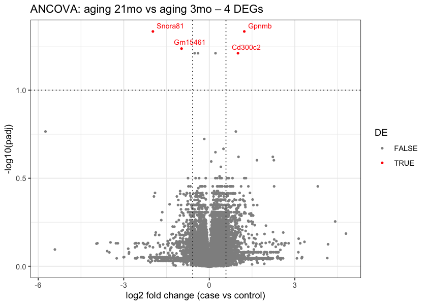
    


    
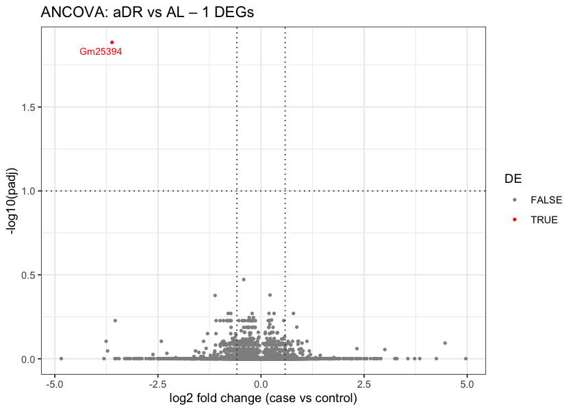
    


    
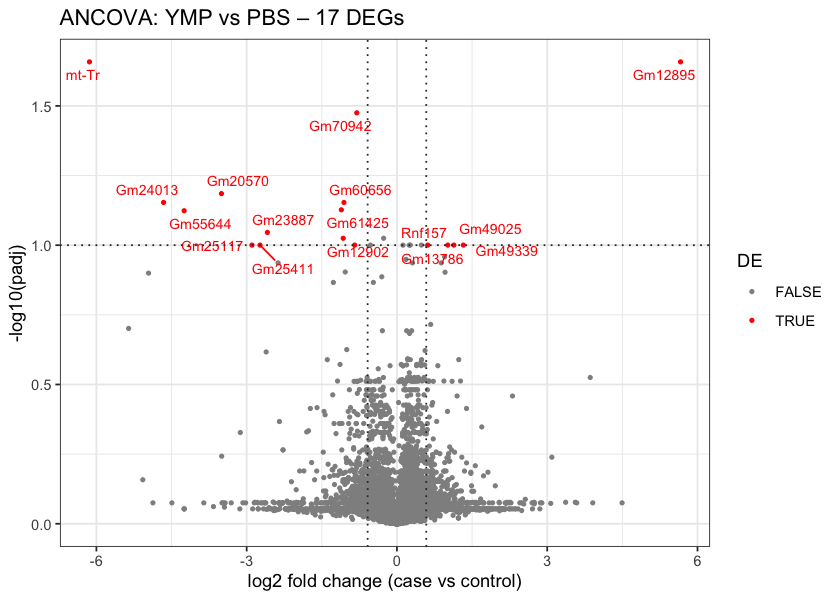
    


### DESeq2
DESeq2 needs counts. `tximport` would sum RSEM's transcript files; the teammates' tables already contain the gene-level output, so we hand it over in the same shape `tximport` produces (counts + TPM + effective length). DESeq2 rounds the counts and uses the lengths to correct for gene length.

As in the tutorial: likelihood ratio test (LRT), full model with the group vs reduced model without it, on the same expressed genes as the ANCOVA.


```R
run_deseq2 <- function(cmp, genes) {
  m <- get_samples(cmp)
  m$group <- factor(m$group, levels = c(cmp$ctrl, cmp$case))   # control first = reference
  m$sex   <- factor(m$sex)

  len <- efflen[, m$SRR]
  len[len == 0] <- 1                                           # DESeq2 needs length > 0
  txi <- list(abundance = expr[, m$SRR], counts = counts[, m$SRR],
              length = len, countsFromAbundance = "no")

  design  <- if (is.null(cmp$covar)) ~ group else ~ sex + group
  reduced <- if (is.null(cmp$covar)) ~ 1     else ~ sex
  dds <- DESeqDataSetFromTximport(txi, colData = m, design = design)
  dds <- DESeq(dds[genes, ], test = "LRT", reduced = reduced, quiet = TRUE)

  as.data.frame(results(dds)) %>%
    rownames_to_column("gene") %>%
    mutate(symbol = sym[gene])
}

res_DESeq2 <- lapply(names(comparisons), function(n) run_deseq2(comparisons[[n]], res_DE[[n]]$gene))
names(res_DESeq2) <- names(comparisons)

sapply(res_DESeq2, function(r) c(genes = nrow(r),
                                 DEGs  = sum(r$padj < padj_cut & abs(r$log2FoldChange) > lfc_cut, na.rm = TRUE)))
```


<table class="dataframe">
<caption>A matrix: 2 × 3 of type int</caption>
<thead>
	<tr><th></th><th scope=col>aging</th><th scope=col>diet</th><th scope=col>ymp</th></tr>
</thead>
<tbody>
	<tr><th scope=row>genes</th><td>26784</td><td>31383</td><td>32383</td></tr>
	<tr><th scope=row>DEGs</th><td>  108</td><td>   40</td><td>   58</td></tr>
</tbody>
</table>


```R
options(repr.plot.width = 7, repr.plot.height = 5)
for (n in names(comparisons)) {
  cmp <- comparisons[[n]]
  print(plot_volcano(res_DESeq2[[n]], paste0("DESeq2: ", cmp$case, " vs ", cmp$ctrl),
                     lfc = "log2FoldChange"))
}
```


    
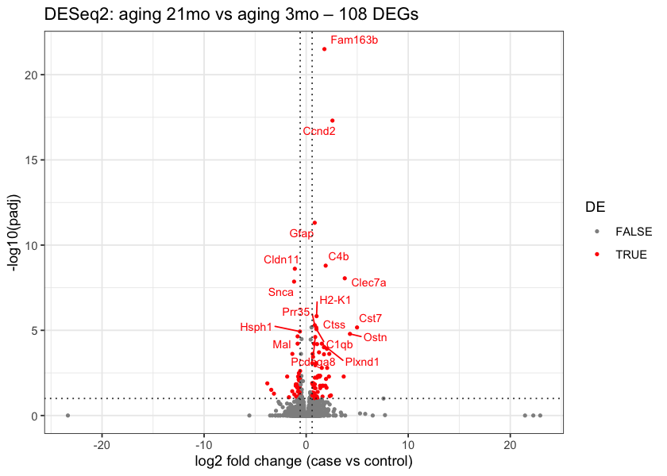
    


    
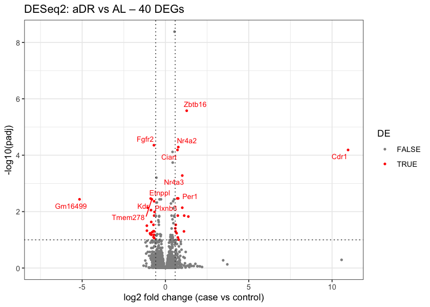
    


    
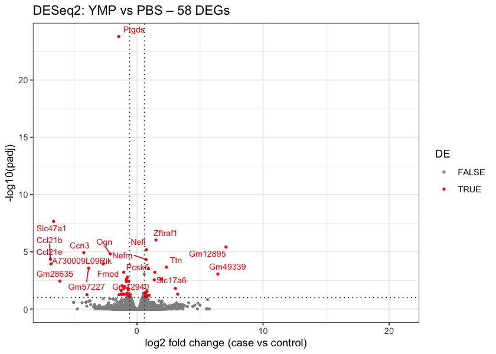
    


### Compare DESeq2 with the ANCOVA


```R
options(repr.plot.width = 12, repr.plot.height = 8)
layout(matrix(1:6, nrow = 2))
for (n in names(comparisons)) {
  a <- res_DE[[n]]
  d <- res_DESeq2[[n]][match(a$gene, res_DESeq2[[n]]$gene), ]
  r <- cor(d$pvalue, a$pval, method = "spearman", use = "complete.obs")
  plot(-log10(d$pvalue), -log10(a$pval), pch = 16, cex = 0.4,
       xlab = "-log10(pval DESeq2)", ylab = "-log10(pval ANCOVA)",
       main = paste0(n, " (Spearman r = ", round(r, 2), ")"))
  abline(0, 1, col = "red")
  smoothScatter(-log10(d$pvalue), -log10(a$pval),
                xlab = "-log10(pval DESeq2)", ylab = "-log10(pval ANCOVA)", main = n)
}
```


    
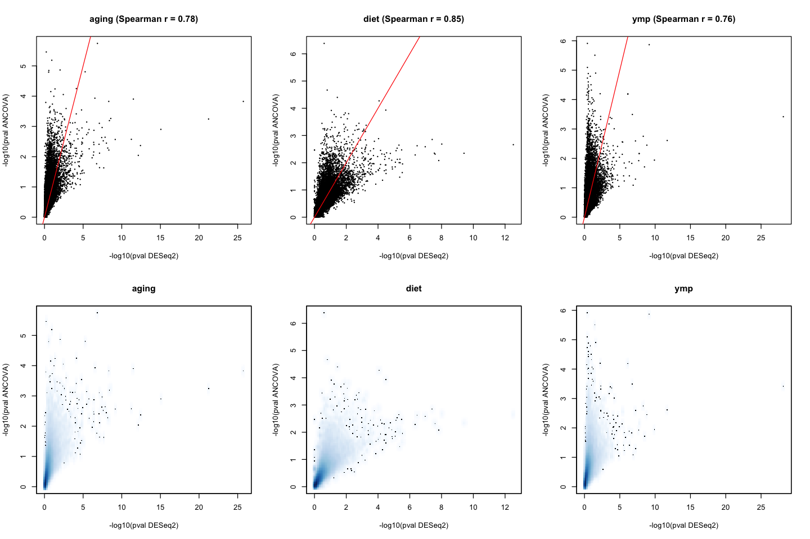
    


```R
# DEG overlap: rows = DESeq2, columns = ANCOVA (padj < 0.1, any fold change)
for (n in names(comparisons)) {
  a <- res_DE[[n]]
  d <- res_DESeq2[[n]][match(a$gene, res_DESeq2[[n]]$gene), ]
  cat("\n", n, "\n")
  print(table(DESeq2 = d$padj < padj_cut, ANCOVA = a$padj < padj_cut, useNA = "ifany"))
}

# Save the DESeq2 tables
for (n in names(comparisons))
  write.csv(res_DESeq2[[n]], file.path(out, paste0("DESeq2_", n, ".csv")), row.names = FALSE)
```

    
     aging 
           ANCOVA
    DESeq2  FALSE  TRUE
      FALSE 16764     2
      TRUE    136     2
      <NA>   9877     3
    
     diet 
           ANCOVA
    DESeq2  FALSE  TRUE
      FALSE 13636     0
      TRUE     78     0
      <NA>  17668     1
    
     ymp 
           ANCOVA
    DESeq2  FALSE  TRUE  <NA>
      FALSE 22221     3     0
      TRUE     68     3     0
      <NA>  10069    17     2


## 3-5 Grouping of the identified DEGs
### Case-control: up- and down-regulated
From here on the DESeq2 results are used (more sensitive, see the comparison above).


```R
degs <- lapply(res_DESeq2, function(r) {
  r <- r[!is.na(r$padj) & r$padj < padj_cut & abs(r$log2FoldChange) > lfc_cut, ]
  list(up = r$gene[r$log2FoldChange > 0], down = r$gene[r$log2FoldChange < 0])
})
sapply(degs, lengths)
```


<table class="dataframe">
<caption>A matrix: 2 × 3 of type int</caption>
<thead>
	<tr><th></th><th scope=col>aging</th><th scope=col>diet</th><th scope=col>ymp</th></tr>
</thead>
<tbody>
	<tr><th scope=row>up</th><td>69</td><td>18</td><td>23</td></tr>
	<tr><th scope=row>down</th><td>39</td><td>22</td><td>35</td></tr>
</tbody>
</table>


```R
# Expression of the up/down DEGs in each sample (log TPM, scaled per gene)
options(repr.plot.width = 12, repr.plot.height = 4)
layout(matrix(1:6, nrow = 1))
par(mar = c(7, 3, 3, 1))
for (n in names(comparisons)) {
  m <- get_samples(comparisons[[n]])
  m <- m[order(m$group != comparisons[[n]]$ctrl), ]          # controls first
  for (dir in c("up", "down")) {
    g <- degs[[n]][[dir]]
    if (length(g) < 2) { plot.new(); title(paste(n, dir, "(< 2 genes)")); next }
    scaled <- t(scale(t(log1p(expr[g, m$SRR]))))
    boxplot(scaled, names = m$group, las = 2, col = ifelse(m$group == comparisons[[n]]$ctrl, "grey80", "salmon"),
            main = paste0(n, " ", dir, " (", length(g), ")"))
  }
}
```


    
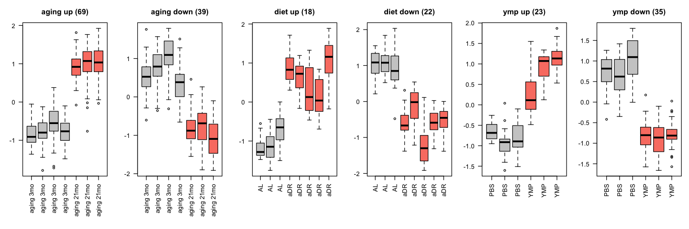
    


```R
# Heatmap of all DEGs per comparison (rows = genes, columns = samples)
library(gplots)
library(viridis)

options(repr.plot.width = 7, repr.plot.height = 7)
for (n in names(comparisons)) {
  g <- unlist(degs[[n]])
  if (length(g) < 2) { cat(n, ": fewer than 2 DEGs, no heatmap\n"); next }
  m <- get_samples(comparisons[[n]])
  heatmap.2(log1p(expr[g, m$SRR]), scale = "row", trace = "none", col = viridis,
            labRow = if (length(g) <= 60) sym[g] else NA, labCol = m$group,
            ColSideColors = ifelse(m$group == comparisons[[n]]$ctrl, "grey60", "salmon"),
            margins = c(8, 6), main = paste(n, "DEGs"))
}
```


    
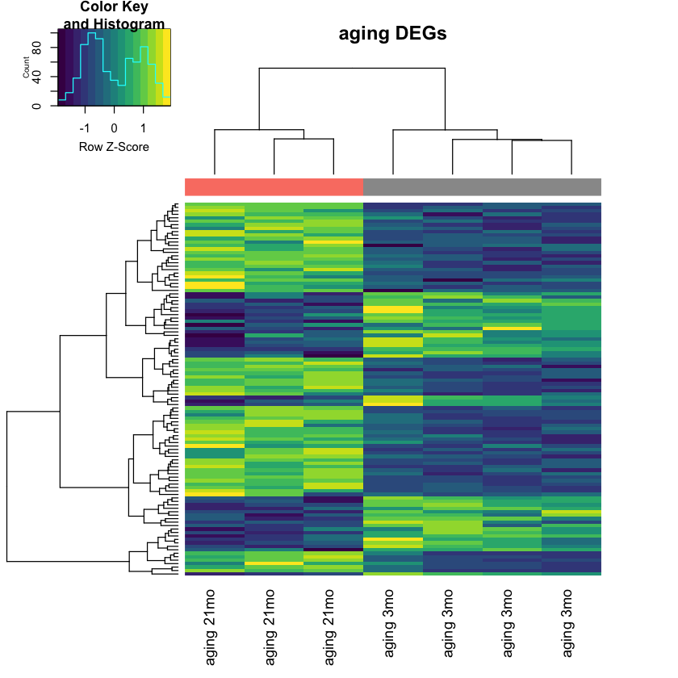
    


    
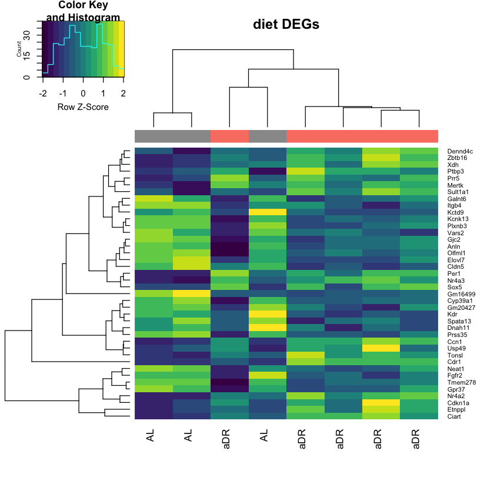
    


    
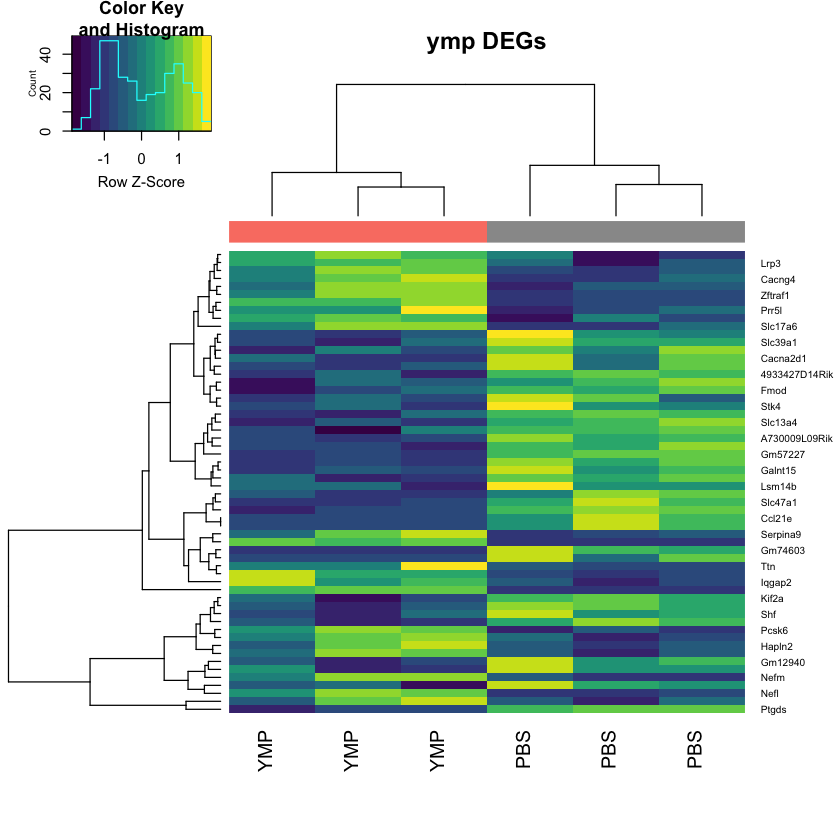
    


### Multi-condition: all three ages (3 / 18 / 21 months)
Like the tutorial's layers: one LRT across all ages (`~ sex + group` vs `~ sex`), then group the DEGs by the age with the highest expression, and by hierarchical clustering.


```R
m_age <- meta[meta$cohort == "Aging", ]
m_age$group <- factor(m_age$group, levels = c("aging 3mo", "aging 18mo", "aging 21mo"))
m_age$sex   <- factor(m_age$sex)

e <- expr[, m_age$SRR]
expressed_age <- rowMeans(e > 0) >= 0.5 | rowMeans(e) >= 1

len <- efflen[, m_age$SRR]
len[len == 0] <- 1
txi <- list(abundance = e, counts = counts[, m_age$SRR], length = len, countsFromAbundance = "no")
dds_age <- DESeqDataSetFromTximport(txi, colData = m_age, design = ~ sex + group)
dds_age <- DESeq(dds_age[expressed_age, ], test = "LRT", reduced = ~ sex, quiet = TRUE)
res_age <- as.data.frame(results(dds_age)) %>% rownames_to_column("gene") %>% mutate(symbol = sym[gene])

DEG_age <- res_age$gene[!is.na(res_age$padj) & res_age$padj < padj_cut]
length(DEG_age)
```


232


```R
# Average expression per age, then: at which age is each DEG highest?
avg_age <- sapply(levels(m_age$group), function(a) rowMeans(expr[, m_age$SRR[m_age$group == a]]))
max_age_DEG <- setNames(colnames(avg_age)[apply(avg_age[DEG_age, ], 1, which.max)], DEG_age)
table(max_age_DEG)

scaled_list <- lapply(split(names(max_age_DEG), max_age_DEG), function(x) t(scale(t(avg_age[x, , drop = FALSE]))))
options(repr.plot.width = 10, repr.plot.height = 4)
layout(matrix(1:3, nrow = 1))
par(mar = c(4, 3, 3, 1))
for (a in levels(m_age$group))
  if (!is.null(scaled_list[[a]]))
    boxplot(scaled_list[[a]], names = c("3mo", "18mo", "21mo"),
            main = paste0("highest at ", a, " (", nrow(scaled_list[[a]]), ")"))
```


    max_age_DEG
    aging 18mo aging 21mo  aging 3mo 
           105         71         56 


    
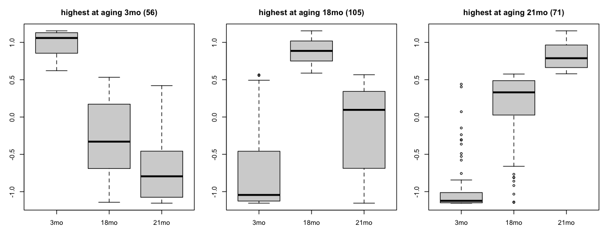
    


```R
# Hierarchical clustering of the DEGs. With only 3 ages, correlating the 3 averages is
# too coarse, so genes are compared across the individual samples (scaled log TPM)
scaled_samples <- t(scale(t(log1p(expr[DEG_age, m_age$SRR[order(m_age$group)]]))))
corr_DEG <- cor(t(scaled_samples))
hcl_DEG  <- hclust(as.dist(1 - corr_DEG), method = "complete")

n_cl   <- 4                                      # number of clusters: try other values
cl_DEG <- cutree(hcl_DEG, k = n_cl)
table(cl_DEG)

options(repr.plot.width = 7, repr.plot.height = 7)
heatmap.2(corr_DEG, Rowv = as.dendrogram(hcl_DEG), Colv = as.dendrogram(hcl_DEG),
          trace = "none", scale = "none", labRow = NA, labCol = NA, col = viridis,
          ColSideColors = rainbow(n_cl)[cl_DEG], main = "Aging DEGs: gene-gene correlation")
```


    cl_DEG
      1   2   3   4 
     49 134  39  10 


    
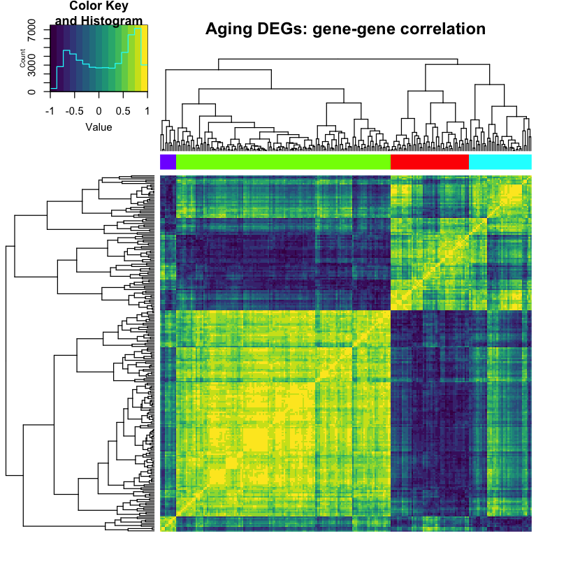
    


```R
# Average pattern of each cluster across ages, in dendrogram order
options(repr.plot.width = 12, repr.plot.height = 4)
layout(matrix(1:n_cl, nrow = 1))
par(mar = c(4, 3, 3, 1))
for (cl in unique(cl_DEG[hcl_DEG$order])) {
  g <- names(cl_DEG)[cl_DEG == cl]
  boxplot(t(scale(t(avg_age[g, , drop = FALSE]))), names = c("3mo", "18mo", "21mo"),
          border = rainbow(n_cl)[cl], main = paste0("cluster ", cl, " (", length(g), ")"))
}
```


    
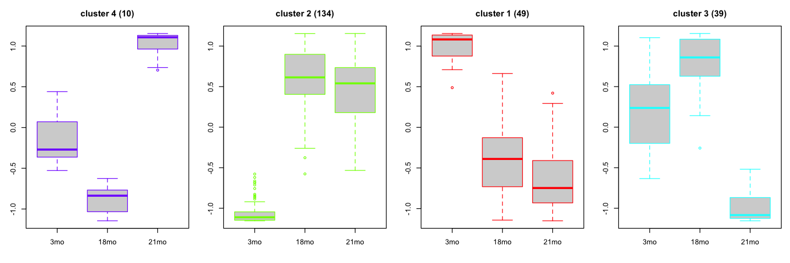
    


## 3-6 Making sense of the genes
### Gene lists for DAVID (frequency-based enrichment)
DAVID takes Ensembl ids **without** the version suffix. Upload a gene list, and as **background** the expressed genes of that comparison (tutorial: this is critical).


```R
david <- file.path(out, "david")
dir.create(david, showWarnings = FALSE)
to_ensembl <- setNames(meta_genes$ensembl, meta_genes$gene_id)

for (n in names(comparisons)) {
  for (dir in c("up", "down"))
    writeLines(to_ensembl[degs[[n]][[dir]]], file.path(david, paste0(n, "_", dir, ".txt")))
  writeLines(to_ensembl[res_DE[[n]]$gene], file.path(david, paste0(n, "_background.txt")))
}
for (cl in sort(unique(cl_DEG)))
  writeLines(to_ensembl[names(cl_DEG)[cl_DEG == cl]], file.path(david, paste0("aging_cluster", cl, ".txt")))
writeLines(to_ensembl[res_age$gene], file.path(david, "aging_all_ages_background.txt"))

list.files(david)
```


<style>
.list-inline {list-style: none; margin:0; padding: 0}
.list-inline>li {display: inline-block}
.list-inline>li:not(:last-child)::after {content: "\00b7"; padding: 0 .5ex}
</style>
<ol class=list-inline><li>'aging_all_ages_background.txt'</li><li>'aging_background.txt'</li><li>'aging_cluster1.txt'</li><li>'aging_cluster2.txt'</li><li>'aging_cluster3.txt'</li><li>'aging_cluster4.txt'</li><li>'aging_down.txt'</li><li>'aging_up.txt'</li><li>'diet_background.txt'</li><li>'diet_down.txt'</li><li>'diet_up.txt'</li><li>'ymp_background.txt'</li><li>'ymp_down.txt'</li><li>'ymp_up.txt'</li></ol>


### GSEA with fgsea (rank-based enrichment)
Every gene gets the score sign(log2FC) × −log10(p) from DESeq2; GSEA checks whether a gene set sits at the top (up in case) or bottom (down in case) of the ranking. Gene sets from MSigDB: **Hallmark** (50 broad processes) and **C8** (cell type signatures, as in the tutorial).


```R
library(msigdbr)
library(fgsea)

get_sets <- function(collection) {
  gs <- msigdbr(species = "Mus musculus", collection = collection)
  tapply(gs$ensembl_gene, gs$gs_name, function(x) unique(x))
}
genesets <- list(hallmark = get_sets("H"), celltype = get_sets("C8"))
lengths(genesets)

gene_scores <- function(r) {
  r <- r[!is.na(r$pvalue), ]
  s <- setNames(sign(r$log2FoldChange) * -log10(r$pvalue), to_ensembl[r$gene])
  sort(s[!duplicated(names(s))], decreasing = TRUE)
}
scores <- lapply(res_DESeq2, gene_scores)

set.seed(42)
gsea <- lapply(scores, function(s)
  lapply(genesets, function(sets) fgsea(pathways = sets, stats = s, minSize = 15, maxSize = 500)))
```


<style>
.dl-inline {width: auto; margin:0; padding: 0}
.dl-inline>dt, .dl-inline>dd {float: none; width: auto; display: inline-block}
.dl-inline>dt::after {content: ":\0020"; padding-right: .5ex}
.dl-inline>dt:not(:first-of-type) {padding-left: .5ex}
</style><dl class=dl-inline><dt>hallmark</dt><dd>50</dd><dt>celltype</dt><dd>863</dd></dl>


```R
# Hallmark: significant sets per comparison (padj < 0.1); NES > 0 = up in case
for (n in names(comparisons)) {
  cat("\n=====", n, "=====\n")
  res <- gsea[[n]]$hallmark[order(NES, decreasing = TRUE)]
  print(res[padj < padj_cut, .(pathway, NES = round(NES, 2), padj = signif(padj, 2), size)])
}
```

    
    ===== aging =====
                                           pathway   NES    padj  size
                                            <char> <num>   <num> <int>
     1:               HALLMARK_ALLOGRAFT_REJECTION  2.42 1.1e-08   164
     2:         HALLMARK_INTERFERON_ALPHA_RESPONSE  2.29 1.7e-05    94
     3:         HALLMARK_INTERFERON_GAMMA_RESPONSE  2.15 1.2e-05   187
     4:                 HALLMARK_KRAS_SIGNALING_UP  1.97 4.7e-04   182
     5:                        HALLMARK_COMPLEMENT  1.94 8.8e-04   170
     6:                      HALLMARK_ANGIOGENESIS  1.82 1.1e-02    34
     7:        HALLMARK_WNT_BETA_CATENIN_SIGNALING  1.79 1.8e-02    39
     8:               HALLMARK_IL2_STAT5_SIGNALING  1.67 1.2e-02   183
     9:             HALLMARK_INFLAMMATORY_RESPONSE  1.51 4.8e-02   164
    10:                         HALLMARK_APOPTOSIS  1.41 5.6e-02   148
    11: HALLMARK_EPITHELIAL_MESENCHYMAL_TRANSITION -1.37 5.6e-02   188
    12:                   HALLMARK_HEME_METABOLISM -1.40 3.7e-02   181
    13:         HALLMARK_OXIDATIVE_PHOSPHORYLATION -1.46 1.1e-02   199
    14:                           HALLMARK_HYPOXIA -1.47 1.9e-02   184
    15:           HALLMARK_CHOLESTEROL_HOMEOSTASIS -1.51 5.4e-02    73
    16:                 HALLMARK_KRAS_SIGNALING_DN -1.54 1.2e-02   141
    17:           HALLMARK_TNFA_SIGNALING_VIA_NFKB -1.64 2.7e-03   179
    18:                 HALLMARK_ANDROGEN_RESPONSE -1.65 1.1e-02    94
    19:                  HALLMARK_MTORC1_SIGNALING -1.98 3.2e-06   201
    20:             HALLMARK_FATTY_ACID_METABOLISM -2.04 5.3e-06   142
                                           pathway   NES    padj  size
    
    ===== diet =====
                                           pathway   NES    padj  size
                                            <char> <num>   <num> <int>
     1:         HALLMARK_OXIDATIVE_PHOSPHORYLATION  2.11 2.4e-07   199
     2:                    HALLMARK_MYC_TARGETS_V1  1.90 2.4e-05   201
     3:           HALLMARK_TNFA_SIGNALING_VIA_NFKB  1.87 6.0e-05   188
     4:                        HALLMARK_DNA_REPAIR  1.86 1.5e-04   150
     5:         HALLMARK_INTERFERON_ALPHA_RESPONSE  1.71 3.7e-03    93
     6:         HALLMARK_INTERFERON_GAMMA_RESPONSE  1.71 6.0e-04   190
     7:                    HALLMARK_UV_RESPONSE_UP  1.68 2.3e-03   154
     8:                           HALLMARK_HYPOXIA  1.62 3.3e-03   189
     9:                    HALLMARK_MYC_TARGETS_V2  1.55 4.3e-02    58
    10:                       HALLMARK_P53_PATHWAY  1.54 6.1e-03   195
    11:         HALLMARK_UNFOLDED_PROTEIN_RESPONSE  1.47 3.5e-02   113
    12:                       HALLMARK_E2F_TARGETS  1.46 1.5e-02   196
    13:                 HALLMARK_KRAS_SIGNALING_DN  1.45 1.9e-02   156
    14:   HALLMARK_REACTIVE_OXYGEN_SPECIES_PATHWAY  1.44 9.8e-02    48
    15:           HALLMARK_PI3K_AKT_MTOR_SIGNALING  1.38 8.0e-02   102
    16:                    HALLMARK_UV_RESPONSE_DN  1.35 5.7e-02   142
    17:                        HALLMARK_GLYCOLYSIS  1.28 5.7e-02   195
    18: HALLMARK_EPITHELIAL_MESENCHYMAL_TRANSITION -1.30 8.0e-02   191
    19:                        HALLMARK_COMPLEMENT -1.32 5.7e-02   175
    20:                   HALLMARK_APICAL_JUNCTION -1.36 5.7e-02   192
    21:           HALLMARK_ESTROGEN_RESPONSE_EARLY -1.44 2.4e-02   185
    22:               HALLMARK_IL2_STAT5_SIGNALING -1.50 1.1e-02   193
    23:                   HALLMARK_MITOTIC_SPINDLE -1.54 9.3e-03   198
    24:                       HALLMARK_COAGULATION -1.64 6.1e-03   111
    25:           HALLMARK_CHOLESTEROL_HOMEOSTASIS -1.74 6.1e-03    73
                                           pathway   NES    padj  size
    
    ===== ymp =====
                                           pathway   NES    padj  size
                                            <char> <num>   <num> <int>
     1:                  HALLMARK_MTORC1_SIGNALING  2.01 2.1e-06   201
     2:                        HALLMARK_GLYCOLYSIS  1.83 1.6e-04   194
     3:           HALLMARK_ESTROGEN_RESPONSE_EARLY  1.82 3.1e-04   185
     4:                      HALLMARK_ADIPOGENESIS  1.75 3.7e-04   196
     5:                       HALLMARK_P53_PATHWAY  1.74 4.1e-04   194
     6:                    HALLMARK_APICAL_SURFACE  1.70 1.5e-02    41
     7:                           HALLMARK_HYPOXIA  1.65 2.2e-03   191
     8:                    HALLMARK_UV_RESPONSE_UP  1.61 8.1e-03   150
     9:                 HALLMARK_ANDROGEN_RESPONSE  1.60 1.8e-02    98
    10:           HALLMARK_TNFA_SIGNALING_VIA_NFKB  1.56 8.1e-03   191
    11:         HALLMARK_OXIDATIVE_PHOSPHORYLATION  1.55 8.1e-03   199
    12:         HALLMARK_UNFOLDED_PROTEIN_RESPONSE  1.54 2.2e-02   113
    13:             HALLMARK_FATTY_ACID_METABOLISM  1.53 1.7e-02   148
    14:           HALLMARK_CHOLESTEROL_HOMEOSTASIS  1.52 3.2e-02    73
    15:                   HALLMARK_APICAL_JUNCTION  1.48 2.1e-02   192
    16:                   HALLMARK_HEME_METABOLISM  1.47 2.1e-02   185
    17:            HALLMARK_ESTROGEN_RESPONSE_LATE  1.46 1.9e-02   188
    18:                   HALLMARK_MITOTIC_SPINDLE  1.46 1.9e-02   199
    19:                   HALLMARK_SPERMATOGENESIS  1.44 4.1e-02   104
    20:        HALLMARK_WNT_BETA_CATENIN_SIGNALING  1.44 9.8e-02    39
    21:                        HALLMARK_COMPLEMENT  1.43 2.6e-02   178
    22:               HALLMARK_IL2_STAT5_SIGNALING  1.41 3.2e-02   189
    23:                        HALLMARK_MYOGENESIS  1.39 3.2e-02   191
    24:                    HALLMARK_UV_RESPONSE_DN -1.37 4.3e-02   143
    25: HALLMARK_EPITHELIAL_MESENCHYMAL_TRANSITION -1.40 4.3e-02   191
    26:                    HALLMARK_G2M_CHECKPOINT -1.43 3.2e-02   197
    27:         HALLMARK_INTERFERON_GAMMA_RESPONSE -1.58 8.8e-03   195
    28:         HALLMARK_INTERFERON_ALPHA_RESPONSE -1.91 6.9e-03    97
                                           pathway   NES    padj  size


```R
# Hallmark NES of all three comparisons side by side (* = padj < 0.1)
nes <- bind_rows(lapply(names(gsea), function(n)
  gsea[[n]]$hallmark %>% as_tibble() %>% transmute(comparison = n, pathway, NES, padj)))
keep <- nes %>% group_by(pathway) %>% filter(any(padj < padj_cut)) %>% pull(pathway) %>% unique()

options(repr.plot.width = 9, repr.plot.height = max(3, 0.3 * length(keep) + 1.5))
nes %>%
  filter(pathway %in% keep) %>%
  mutate(pathway = sub("HALLMARK_", "", pathway),
         comparison = factor(comparison, levels = names(comparisons))) %>%
  ggplot(aes(comparison, reorder(pathway, NES), fill = NES)) +
  geom_tile() +
  geom_text(aes(label = ifelse(padj < padj_cut, "*", "")), size = 6, vjust = 0.75) +
  scale_fill_gradient2(low = "steelblue", mid = "white", high = "firebrick") +
  labs(x = NULL, y = NULL, title = "Hallmark gene sets (GSEA)") +
  theme_bw()
```


    
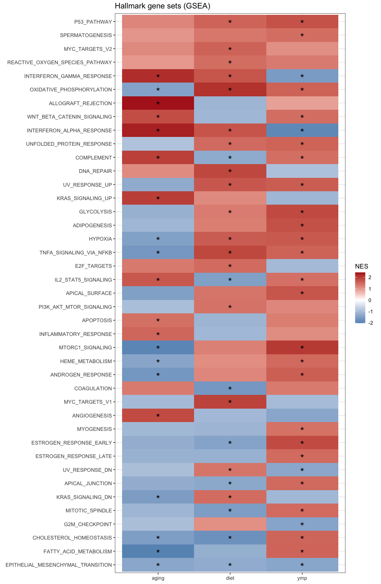
    


```R
# Cell type signatures (C8): top 10 up and down for each comparison
for (n in names(comparisons)) {
  res <- gsea[[n]]$celltype
  cat("\n=====", n, ": up in", comparisons[[n]]$case, "=====\n")
  print(res[order(NES, decreasing = TRUE)][1:10, .(pathway, NES = round(NES, 2), padj = signif(padj, 2))])
  cat("\n=====", n, ": down in", comparisons[[n]]$case, "=====\n")
  print(res[order(NES)][1:10, .(pathway, NES = round(NES, 2), padj = signif(padj, 2))])
}
```

    
    ===== aging : up in aging 21mo =====
                                                 pathway   NES    padj
                                                  <char> <num>   <num>
     1:             DESCARTES_FETAL_CEREBELLUM_MICROGLIA  2.48 1.9e-09
     2:      SU_HO_CONV_CENT_CHONDROSARCOMA_C6_LEUKOCYTE  2.41 2.0e-07
     3:          DESCARTES_FETAL_INTESTINE_MYELOID_CELLS  2.39 2.3e-05
     4: DURANTE_ADULT_OLFACTORY_NEUROEPITHELIUM_NK_CELLS  2.38 9.9e-05
     5:               DESCARTES_FETAL_CEREBRUM_MICROGLIA  2.37 1.5e-06
     6:                  TRAVAGLINI_LUNG_MACROPHAGE_CELL  2.36 7.7e-06
     7:            DESCARTES_FETAL_STOMACH_MYELOID_CELLS  2.33 1.3e-05
     8:                 TRAVAGLINI_LUNG_CD8_NAIVE_T_CELL  2.33 1.7e-04
     9:                AIZARANI_LIVER_C2_KUPFFER_CELLS_1  2.33 2.0e-05
    10:                    DESCARTES_FETAL_EYE_MICROGLIA  2.32 8.7e-06
    
    ===== aging : down in aging 21mo =====
                                                         pathway   NES    padj
                                                          <char> <num>   <num>
     1:                                   FAN_EMBRYONIC_CTX_OLIG -2.66 5.2e-19
     2:                                      HU_FETAL_RETINA_RGC -2.38 2.2e-11
     3:                               ZHONG_PFC_C4_PTGDS_POS_OPC -2.34 2.8e-06
     4: DURANTE_ADULT_OLFACTORY_NEUROEPITHELIUM_IMMATURE_NEURONS -2.13 5.1e-05
     5:                       FAN_EMBRYONIC_CTX_BIG_GROUPS_GLIAL -2.10 8.6e-05
     6:                          MANNO_MIDBRAIN_NEUROTYPES_HOMTN -2.08 6.4e-05
     7:                       MENON_FETAL_KIDNEY_3_STROMAL_CELLS -1.99 2.6e-03
     8:                                    FAN_EMBRYONIC_CTX_OPC -1.97 6.8e-03
     9:                         MANNO_MIDBRAIN_NEUROTYPES_HRGL2B -1.96 4.2e-05
    10:            MENON_FETAL_KIDNEY_2_NEPHRON_PROGENITOR_CELLS -1.95 5.0e-03
    
    ===== diet : up in aDR =====
                                                            pathway   NES    padj
                                                             <char> <num>   <num>
     1:                           BUSSLINGER_GASTRIC_PARIETAL_CELLS  2.13 7.7e-06
     2:                   FAN_OVARY_CL0_XBP1_SELK_HIGH_STROMAL_CELL  2.04 7.1e-04
     3:                    FAN_OVARY_CL14_MATURE_SMOOTH_MUSCLE_CELL  2.02 3.0e-05
     4:                     TRAVAGLINI_LUNG_BRONCHIAL_VESSEL_1_CELL  1.99 5.7e-04
     5:              HE_LIM_SUN_FETAL_LUNG_C0_MID_AIRWAY_SMC_2_CELL  1.99 8.2e-04
     6:              ZHENG_CORD_BLOOD_C6_HSC_MULTIPOTENT_PROGENITOR  1.95 1.7e-03
     7: FAN_OVARY_CL2_PUTATIVE_EARLY_ATRETIC_FOLLICLE_THECAL_CELL_1  1.95 3.2e-03
     8:       DESCARTES_FETAL_INTESTINE_INTESTINAL_EPITHELIAL_CELLS  1.94 3.6e-03
     9:        FAN_OVARY_CL10_PUTATIVE_EARLY_ATRESIA_GRANULOSA_CELL  1.91 2.5e-04
    10:              MENON_FETAL_KIDNEY_7_LOOPOF_HENLE_CELLS_DISTAL  1.90 5.7e-04
    
    ===== diet : down in aDR =====
                                                                       pathway
                                                                        <char>
     1:                                                 FAN_EMBRYONIC_CTX_OLIG
     2:     DURANTE_ADULT_OLFACTORY_NEUROEPITHELIUM_OLFACTORY_ENSHEATHING_GLIA
     3:                                              ZHONG_PFC_MAJOR_TYPES_OPC
     4:         LAKE_ADULT_KIDNEY_C16_COLLECTING_SYSTEM_PRINCIPAL_CELLS_CORTEX
     5: DESCARTES_MAIN_FETAL_SYNCYTIOTROPHOBLASTS_AND_VILLOUS_CYTOTROPHOBLASTS
     6:                              HE_LIM_SUN_FETAL_LUNG_C7_MID_SCHWANN_CELL
     7:                            DESCARTES_FETAL_CEREBELLUM_OLIGODENDROCYTES
     8:                           RUBENSTEIN_SKELETAL_MUSCLE_ENDOTHELIAL_CELLS
     9:                                 DESCARTES_MAIN_FETAL_ENDOCARDIAL_CELLS
    10:                CUI_DEVELOPING_HEART_CORONARY_VASCULAR_ENDOTHELIAL_CELL
          NES    padj
        <num>   <num>
     1: -2.37 2.1e-13
     2: -1.95 1.1e-03
     3: -1.93 3.2e-03
     4: -1.90 4.7e-03
     5: -1.88 6.7e-03
     6: -1.83 1.1e-03
     7: -1.82 1.7e-02
     8: -1.80 3.2e-03
     9: -1.79 1.4e-02
    10: -1.79 1.1e-02
    
    ===== ymp : up in YMP =====
                                                               pathway   NES
                                                                <char> <num>
     1:                                      ZHONG_PFC_MAJOR_TYPES_OPC  2.16
     2:                                      MURARO_PANCREAS_BETA_CELL  2.10
     3:                                         FAN_EMBRYONIC_CTX_OLIG  2.08
     4:                              AIZARANI_LIVER_C12_NK_NKT_CELLS_4  2.01
     5:                   HE_LIM_SUN_FETAL_LUNG_C7_SST_POS_NEURON_CELL  1.99
     6: LAKE_ADULT_KIDNEY_C22_ENDOTHELIAL_CELLS_GLOMERULAR_CAPILLARIES  1.98
     7:                 SU_HO_FOETAL_FEMUR_C2_HYPERTROPHIC_CHONDROCYTE  1.94
     8:                               ZHONG_PFC_MAJOR_TYPES_ASTROCYTES  1.93
     9:                    DESCARTES_FETAL_CEREBELLUM_OLIGODENDROCYTES  1.92
    10:                                    HAY_BONE_MARROW_PLASMA_CELL  1.89
           padj
          <num>
     1: 3.5e-04
     2: 4.1e-10
     3: 2.7e-07
     4: 3.7e-03
     5: 1.6e-03
     6: 4.2e-03
     7: 1.3e-04
     8: 2.5e-04
     9: 1.2e-02
    10: 1.2e-02
    
    ===== ymp : down in YMP =====
                                                              pathway   NES   padj
                                                               <char> <num>  <num>
     1:              HE_LIM_SUN_FETAL_LUNG_C3_VENOUS_ENDOTHELIAL_CELL -2.26 0.0410
     2:                   DESCARTES_FETAL_INTESTINE_MESOTHELIAL_CELLS -2.26 0.0140
     3:                                     TRAVAGLINI_LUNG_VEIN_CELL -2.18 0.0035
     4:                                     TRAVAGLINI_LUNG_CLUB_CELL -2.11 0.0750
     5:              DURANTE_ADULT_OLFACTORY_NEUROEPITHELIUM_NK_CELLS -2.09 0.0380
     6:                     BUSSLINGER_GASTRIC_PPP1R1B_POSITIVE_CELLS -2.07 0.0012
     7:                      SU_HO_FOETAL_FEMUR_C0_TRANSITIONING_CELL -2.06 0.0023
     8:                          DESCARTES_FETAL_MUSCLE_STROMAL_CELLS -2.06 0.0730
     9:   GAUTAM_EYE_IRIS_CILIARY_BODY_COL9A1_HIGH_CILIARY_BODY_CELLS -2.02 0.0910
    10: HE_LIM_SUN_FETAL_LUNG_C1_MUC5AC_POS_ASCL1_POS_PROGENITOR_CELL -2.01 0.0096


```R
# Enrichment plot of the strongest Hallmark set in the aging comparison
top <- gsea$aging$hallmark[order(pval)]$pathway[1]
options(repr.plot.width = 7, repr.plot.height = 4)
plotEnrichment(genesets$hallmark[[top]], scores$aging) +
  labs(title = paste("aging 21 vs 3 mo:", top))
```


    
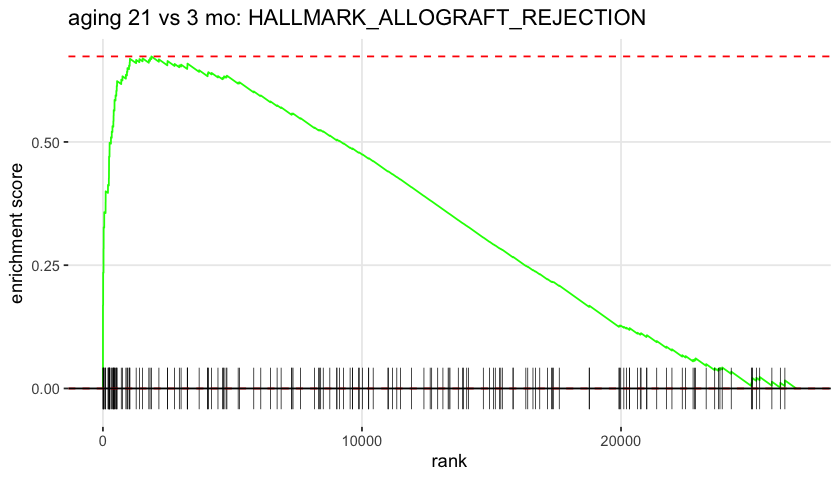
    


## 3-7 Other analysis
### Cell type composition (marker genes)
Real deconvolution (CIBERSORTx, quadratic programming) needs a single-cell reference of the cerebellum, which we do not have here. A simpler estimate: for each cell type, the mean log(TPM + 1) of a few well-known marker genes. A change in this score between groups suggests a change in how much of that cell type is in the tissue (or a change in its marker expression; the score cannot tell the two apart).

Only the 25 clean samples are used here.


```R
markers <- list(
  "Granule cells"      = c("Gabra6", "Cbln3", "Neurod1", "Pax6"),
  "Purkinje cells"     = c("Pcp2", "Calb1", "Car8", "Pcp4"),
  "Bergmann glia/astro"= c("Gdf10", "Aqp4", "Slc1a3", "Aldh1l1"),
  "Oligodendrocytes"   = c("Mbp", "Plp1", "Mog", "Mobp"),
  "OPC"                = c("Pdgfra", "Cspg4", "Vcan"),
  "Microglia"          = c("P2ry12", "Cx3cr1", "Tmem119", "Csf1r"),
  "Endothelial"        = c("Cldn5", "Flt1", "Pecam1"),
  "Red blood cells"    = c("Hba-a1", "Hbb-bs", "Alas2"),
  "Neutrophils"        = c("S100a8", "S100a9", "Ngp")
)

# The 25 clean samples
expr_all <- expr
meta_all <- meta

sym_to_id <- setNames(meta_genes$gene_id, meta_genes$symbol)
missing <- setdiff(unlist(markers), names(sym_to_id))
if (length(missing) > 0) cat("not found:", missing, "\n")

celltype_score <- sapply(markers, function(g) colMeans(log1p(expr_all[sym_to_id[intersect(g, names(sym_to_id))], , drop = FALSE])))
round(celltype_score, 2)
```


<table class="dataframe">
<caption>A matrix: 25 × 9 of type dbl</caption>
<thead>
	<tr><th></th><th scope=col>Granule cells</th><th scope=col>Purkinje cells</th><th scope=col>Bergmann glia/astro</th><th scope=col>Oligodendrocytes</th><th scope=col>OPC</th><th scope=col>Microglia</th><th scope=col>Endothelial</th><th scope=col>Red blood cells</th><th scope=col>Neutrophils</th></tr>
</thead>
<tbody>
	<tr><th scope=row>SRR21355401</th><td>5.33</td><td>7.49</td><td>4.53</td><td>6.45</td><td>0.93</td><td>2.04</td><td>2.87</td><td>2.11</td><td>1.79</td></tr>
	<tr><th scope=row>SRR21355396</th><td>5.27</td><td>7.43</td><td>4.60</td><td>6.53</td><td>0.93</td><td>2.26</td><td>2.69</td><td>4.37</td><td>4.35</td></tr>
	<tr><th scope=row>SRR21355392</th><td>5.23</td><td>7.38</td><td>4.57</td><td>6.83</td><td>0.89</td><td>2.43</td><td>2.78</td><td>3.00</td><td>2.43</td></tr>
	<tr><th scope=row>SRR21355388</th><td>5.33</td><td>7.53</td><td>4.63</td><td>6.34</td><td>0.87</td><td>2.20</td><td>2.47</td><td>2.11</td><td>0.79</td></tr>
	<tr><th scope=row>SRR21355398</th><td>4.97</td><td>7.35</td><td>4.65</td><td>6.69</td><td>0.93</td><td>2.64</td><td>2.44</td><td>3.79</td><td>0.61</td></tr>
	<tr><th scope=row>SRR21355394</th><td>5.31</td><td>7.41</td><td>4.68</td><td>6.57</td><td>0.92</td><td>2.72</td><td>2.81</td><td>4.00</td><td>3.21</td></tr>
	<tr><th scope=row>SRR21355390</th><td>5.23</td><td>7.43</td><td>4.61</td><td>6.26</td><td>1.00</td><td>2.48</td><td>2.84</td><td>3.64</td><td>3.10</td></tr>
	<tr><th scope=row>SRR21355386</th><td>5.28</td><td>7.35</td><td>4.64</td><td>6.61</td><td>1.14</td><td>2.69</td><td>2.73</td><td>2.60</td><td>2.54</td></tr>
	<tr><th scope=row>SRR21355397</th><td>5.33</td><td>7.46</td><td>4.64</td><td>6.03</td><td>0.94</td><td>2.44</td><td>2.71</td><td>3.19</td><td>3.30</td></tr>
	<tr><th scope=row>SRR21355393</th><td>5.16</td><td>7.57</td><td>4.60</td><td>6.31</td><td>0.81</td><td>2.64</td><td>2.59</td><td>0.82</td><td>0.83</td></tr>
	<tr><th scope=row>SRR21355385</th><td>5.37</td><td>7.53</td><td>4.66</td><td>5.91</td><td>0.82</td><td>2.33</td><td>2.66</td><td>4.45</td><td>4.50</td></tr>
	<tr><th scope=row>SRR23914577</th><td>5.17</td><td>7.30</td><td>4.60</td><td>6.91</td><td>1.15</td><td>2.64</td><td>2.60</td><td>3.01</td><td>2.28</td></tr>
	<tr><th scope=row>SRR23914574</th><td>5.15</td><td>7.25</td><td>4.65</td><td>6.74</td><td>1.21</td><td>2.60</td><td>2.78</td><td>2.64</td><td>1.46</td></tr>
	<tr><th scope=row>SRR23914571</th><td>5.35</td><td>7.39</td><td>4.76</td><td>6.44</td><td>1.21</td><td>2.75</td><td>2.67</td><td>3.63</td><td>3.17</td></tr>
	<tr><th scope=row>SRR23914579</th><td>5.41</td><td>7.56</td><td>4.90</td><td>6.25</td><td>1.10</td><td>2.68</td><td>2.46</td><td>3.84</td><td>3.61</td></tr>
	<tr><th scope=row>SRR23914578</th><td>5.27</td><td>7.28</td><td>4.78</td><td>6.76</td><td>0.95</td><td>2.73</td><td>2.41</td><td>4.52</td><td>1.48</td></tr>
	<tr><th scope=row>SRR23914576</th><td>5.25</td><td>7.64</td><td>4.75</td><td>5.85</td><td>1.08</td><td>2.51</td><td>2.51</td><td>3.48</td><td>2.63</td></tr>
	<tr><th scope=row>SRR23914575</th><td>5.16</td><td>7.49</td><td>4.59</td><td>6.35</td><td>1.03</td><td>2.52</td><td>2.48</td><td>1.16</td><td>0.23</td></tr>
	<tr><th scope=row>SRR23914573</th><td>5.33</td><td>7.10</td><td>4.70</td><td>6.57</td><td>0.96</td><td>2.70</td><td>2.45</td><td>2.81</td><td>2.41</td></tr>
	<tr><th scope=row>SRR23914455</th><td>5.26</td><td>7.28</td><td>4.66</td><td>6.57</td><td>1.03</td><td>2.70</td><td>2.81</td><td>2.70</td><td>1.42</td></tr>
	<tr><th scope=row>SRR23914452</th><td>5.33</td><td>7.46</td><td>4.62</td><td>6.22</td><td>0.98</td><td>2.48</td><td>2.72</td><td>4.20</td><td>3.97</td></tr>
	<tr><th scope=row>SRR23914450</th><td>5.34</td><td>7.54</td><td>4.89</td><td>6.43</td><td>1.37</td><td>2.74</td><td>3.09</td><td>4.16</td><td>3.44</td></tr>
	<tr><th scope=row>SRR23914454</th><td>5.24</td><td>7.54</td><td>4.73</td><td>6.41</td><td>1.15</td><td>2.68</td><td>2.98</td><td>3.59</td><td>3.32</td></tr>
	<tr><th scope=row>SRR23914453</th><td>5.34</td><td>7.39</td><td>4.82</td><td>6.88</td><td>1.24</td><td>3.03</td><td>2.88</td><td>2.19</td><td>1.80</td></tr>
	<tr><th scope=row>SRR23914451</th><td>5.39</td><td>7.35</td><td>4.77</td><td>7.00</td><td>1.31</td><td>3.06</td><td>2.80</td><td>2.02</td><td>0.36</td></tr>
</tbody>
</table>


```R
group_order <- c("aging 3mo", "aging 18mo", "aging 21mo", "AL", "aDR", "PBS", "YMP")
score_long <- data.frame(meta_all, celltype_score, check.names = FALSE) %>%
  pivot_longer(names(markers), names_to = "cell_type", values_to = "score") %>%
  mutate(group = factor(group, levels = group_order),
         cell_type = factor(cell_type, levels = names(markers)))

options(repr.plot.width = 13, repr.plot.height = 9)
ggplot(score_long, aes(group, score, colour = cohort)) +
  geom_boxplot(outlier.shape = NA, colour = "grey60") +
  geom_point(size = 2, position = position_jitter(width = 0.15, seed = 1)) +
  facet_wrap(~ cell_type, scales = "free_y") +
  labs(x = NULL, y = "mean log(TPM + 1) of markers", title = "Cell type marker scores") +
  theme_bw() +
  theme(axis.text.x = element_text(angle = 45, hjust = 1), legend.position = "bottom")
```


    
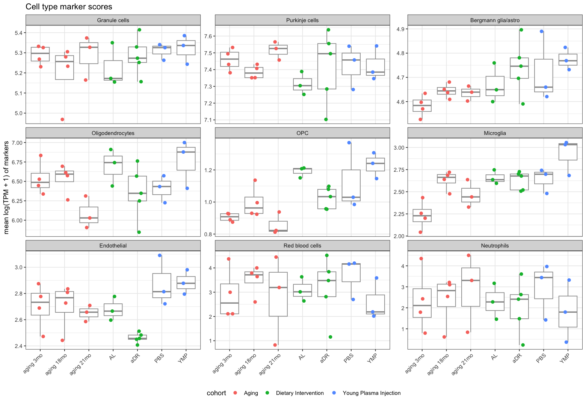
    


```R
# Test each marker score per comparison (same models as the ANCOVA)
score_test <- bind_rows(lapply(names(comparisons), function(n) {
  cmp <- comparisons[[n]]
  m <- get_samples(cmp)
  bind_rows(lapply(names(markers), function(ct) {
    dat <- data.frame(y = celltype_score[m$SRR, ct], group = factor(m$group, levels = c(cmp$ctrl, cmp$case)), sex = m$sex)
    f1 <- if (is.null(cmp$covar)) y ~ group else y ~ sex + group
    f0 <- if (is.null(cmp$covar)) y ~ 1     else y ~ sex
    data.frame(comparison = n, cell_type = ct,
               diff = coef(lm(f1, dat))[[paste0("group", cmp$case)]],   # case - control
               pval = anova(lm(f1, dat), lm(f0, dat))$Pr[2])
  }))
})) %>%
  mutate(padj = p.adjust(pval, method = "BH"))

options(repr.plot.width = 7, repr.plot.height = 5)
ggplot(score_test, aes(factor(comparison, levels = names(comparisons)),
                       factor(cell_type, levels = rev(names(markers))), fill = diff)) +
  geom_tile() +
  geom_text(aes(label = ifelse(padj < padj_cut, "*", "")), size = 6, vjust = 0.75) +
  scale_fill_gradient2(low = "steelblue", mid = "white", high = "firebrick") +
  labs(x = NULL, y = NULL, fill = "case - control",
       title = "Marker score change (* = padj < 0.1)") +
  theme_bw()
```


    
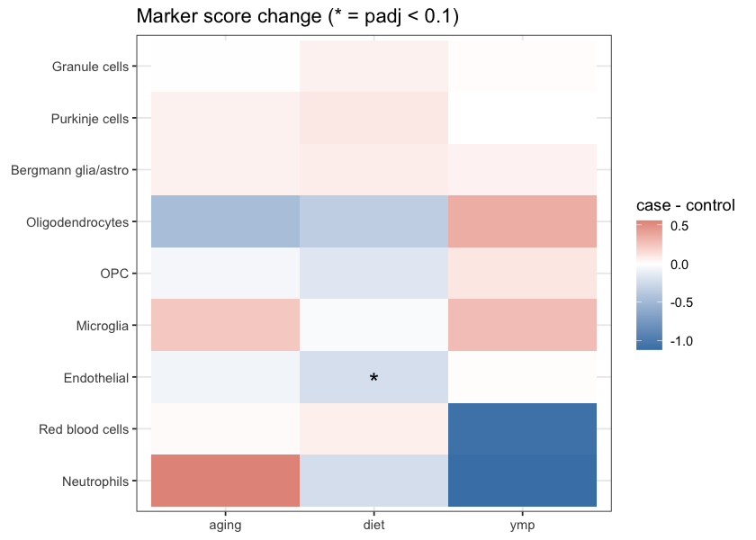
    


### Alternative splicing: isoform usage
rMATS needs the read alignments (BAM files), which are not here. But RSEM also estimated, per sample, how much each **isoform** (transcript) contributes to its gene (`IsoPct`, in %). These `*.isoforms.results` files are in your own Euler output (`euler_results/rsem_trimmed`, same RSEM run as the teammates' tables). A change in an isoform's share between groups, while the gene itself may stay the same, is called **differential transcript usage** (DTU), a sign of alternative splicing (or alternative start/end).

Caution: isoform shares from short reads are uncertain, especially for low-expressed genes, so only isoforms with TPM ≥ 1 and a share ≥ 5 % are tested.


```R
library(data.table)
iso_dir <- "~/Documents/claude/Claude/Systems Genomics/euler_results/rsem_trimmed"

iso <- lapply(meta$SRR, function(s)
  fread(file.path(iso_dir, s, paste0(s, ".isoforms.results")), select = c("transcript_id", "gene_id", "TPM", "IsoPct")))
stopifnot(all(sapply(iso, function(x) identical(x$transcript_id, iso[[1]]$transcript_id))))

tx2gene <- data.frame(transcript_id = iso[[1]]$transcript_id, gene_id = iso[[1]]$gene_id)
iso_tpm <- sapply(iso, `[[`, "TPM");    dimnames(iso_tpm) <- list(tx2gene$transcript_id, meta$SRR)
iso_pct <- sapply(iso, `[[`, "IsoPct"); dimnames(iso_pct) <- list(tx2gene$transcript_id, meta$SRR)
rm(iso)
dim(iso_pct)   # transcripts x samples
```


<style>
.list-inline {list-style: none; margin:0; padding: 0}
.list-inline>li {display: inline-block}
.list-inline>li:not(:last-child)::after {content: "\00b7"; padding: 0 .5ex}
</style>
<ol class=list-inline><li>481871</li><li>25</li></ol>


```R
dtu_test <- function(cmp, genes) {
  m <- get_samples(cmp)
  tx <- tx2gene$gene_id %in% genes &
        rowMeans(iso_tpm[, m$SRR]) >= 1 & rowMeans(iso_pct[, m$SRR]) >= 5
  multi <- names(which(table(tx2gene$gene_id[tx]) >= 2))     # genes with >= 2 such isoforms
  tx <- tx & tx2gene$gene_id %in% multi

  covar <- if (is.null(cmp$covar)) NULL else m[, cmp$covar, drop = FALSE]
  res <- data.frame(t(pbapply(iso_pct[tx, m$SRR], 1, function(p) {
    dat <- data.frame(y = p, cond = m$group)
    if (!is.null(covar)) dat <- data.frame(dat, covar)
    pval <- anova(lm(y ~ ., data = dat), lm(y ~ . - cond, data = dat))$Pr[2]
    avgs <- tapply(p, m$group, mean)
    c(pval = pval, delta = unname(avgs[cmp$case] - avgs[cmp$ctrl]))   # change in % share
  })))
  res$padj <- p.adjust(res$pval, method = "BH")
  res %>% rownames_to_column("transcript_id") %>%
    mutate(gene_id = tx2gene$gene_id[match(transcript_id, tx2gene$transcript_id)],
           symbol  = sym[gene_id])
}

res_dtu <- lapply(names(comparisons), function(n) dtu_test(comparisons[[n]], res_DE[[n]]$gene))
names(res_dtu) <- names(comparisons)

dpct_cut <- 10   # at least 10 percentage points change in isoform share
sapply(res_dtu, function(r) c(isoforms_tested = nrow(r),
                              genes_tested    = length(unique(r$gene_id)),
                              DTU_isoforms    = sum(r$padj < padj_cut & abs(r$delta) > dpct_cut),
                              DTU_genes       = length(unique(r$gene_id[r$padj < padj_cut & abs(r$delta) > dpct_cut]))))
```


<table class="dataframe">
<caption>A matrix: 4 × 3 of type int</caption>
<thead>
	<tr><th></th><th scope=col>aging</th><th scope=col>diet</th><th scope=col>ymp</th></tr>
</thead>
<tbody>
	<tr><th scope=row>isoforms_tested</th><td>34252</td><td>35491</td><td>36569</td></tr>
	<tr><th scope=row>genes_tested</th><td> 9335</td><td> 9600</td><td> 9750</td></tr>
	<tr><th scope=row>DTU_isoforms</th><td>    0</td><td>    0</td><td>    2</td></tr>
	<tr><th scope=row>DTU_genes</th><td>    0</td><td>    0</td><td>    2</td></tr>
</tbody>
</table>


```R
# Volcano: change in isoform share vs significance
options(repr.plot.width = 7, repr.plot.height = 5)
for (n in names(comparisons)) {
  r <- res_dtu[[n]]
  r$DTU <- r$padj < padj_cut & abs(r$delta) > dpct_cut
  top <- rank(r$padj, ties.method = "first") <= 15
  r$label <- ifelse(r$DTU & top, r$symbol, NA)
  print(ggplot(r, aes(delta, -log10(padj), colour = DTU, label = label)) +
    geom_point(size = 0.8) +
    geom_text_repel(size = 3, max.overlaps = 30, na.rm = TRUE, show.legend = FALSE) +
    geom_vline(xintercept = c(-dpct_cut, dpct_cut), col = "#303030", linetype = "dotted") +
    geom_hline(yintercept = -log10(padj_cut), col = "#303030", linetype = "dotted") +
    scale_colour_manual(values = c(`FALSE` = "#909090", `TRUE` = "darkorange")) +
    labs(x = "change in isoform share (percentage points, case - control)", y = "-log10(padj)",
         title = paste0("Isoform usage: ", comparisons[[n]]$case, " vs ", comparisons[[n]]$ctrl,
                        " – ", length(unique(r$gene_id[r$DTU])), " genes")) +
    theme_bw())
}
```


    
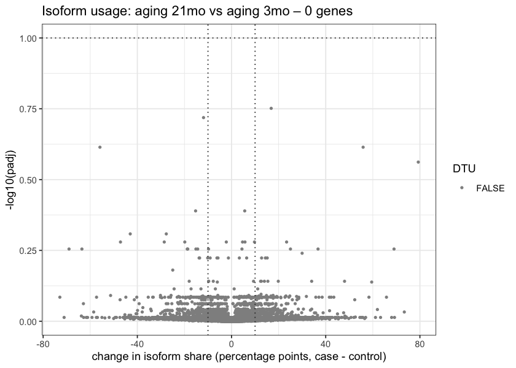
    


    
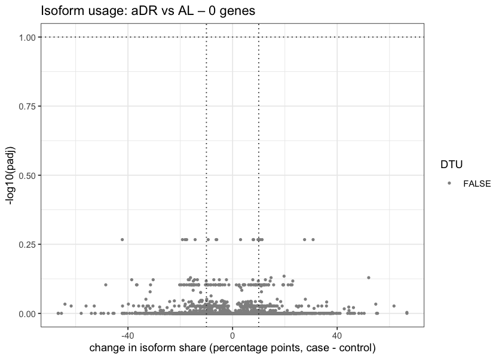
    


    
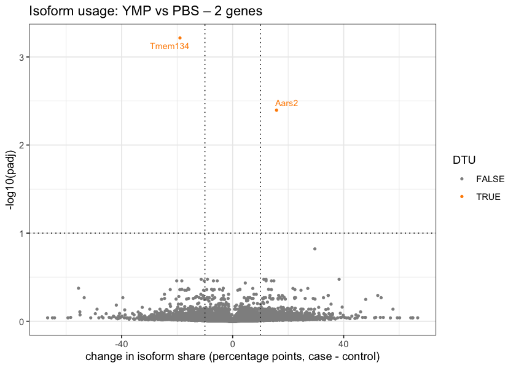
    


```R
# Isoform shares of the top DTU gene per comparison: one bar per sample
plot_isoforms <- function(n) {
  r <- res_dtu[[n]]
  g <- r$gene_id[order(r$padj)][1]
  m <- get_samples(comparisons[[n]])
  m <- m[order(m$group != comparisons[[n]]$ctrl), ]                  # controls first
  tx <- tx2gene$transcript_id[tx2gene$gene_id == g]
  tx <- tx[rowMeans(iso_pct[tx, m$SRR, drop = FALSE]) >= 5]           # isoforms with >= 5 % share
  d <- data.frame(transcript = rep(tx, times = nrow(m)),
                  sample = rep(paste(m$group, substr(m$SRR, 9, 11)), each = length(tx)),
                  pct = as.vector(iso_pct[tx, m$SRR]))
  d$sample <- factor(d$sample, levels = unique(d$sample))
  ggplot(d, aes(sample, pct, fill = transcript)) +
    geom_col() +
    labs(x = NULL, y = "isoform share (%)",
         title = paste0(n, ": ", sym[g], " (gene TPM ", round(mean(expr[g, m$SRR])),
                        ", best isoform padj ", signif(min(r$padj), 2), ")")) +
    theme_bw() +
    theme(axis.text.x = element_text(angle = 45, hjust = 1))
}

options(repr.plot.width = 8, repr.plot.height = 4.5)
for (n in names(comparisons)) print(plot_isoforms(n))
```


    
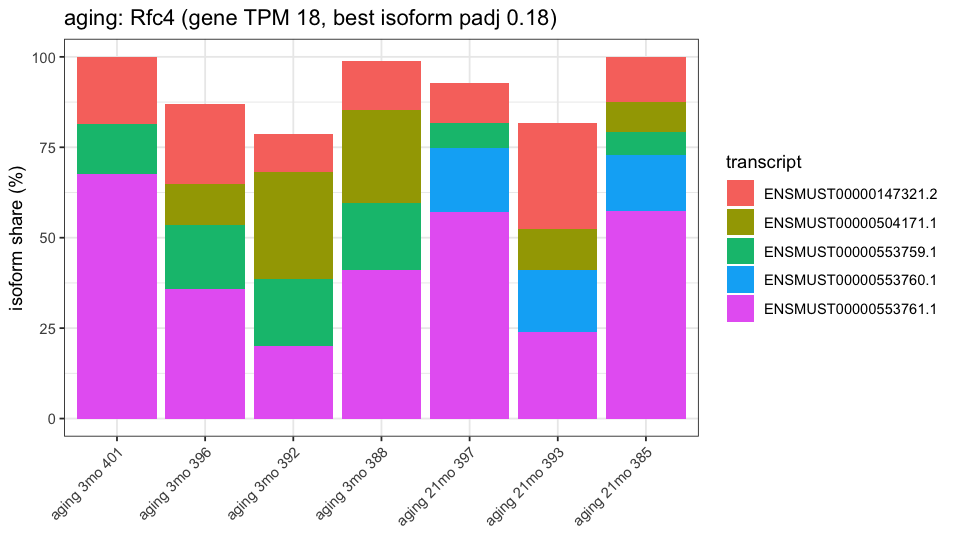
    


    
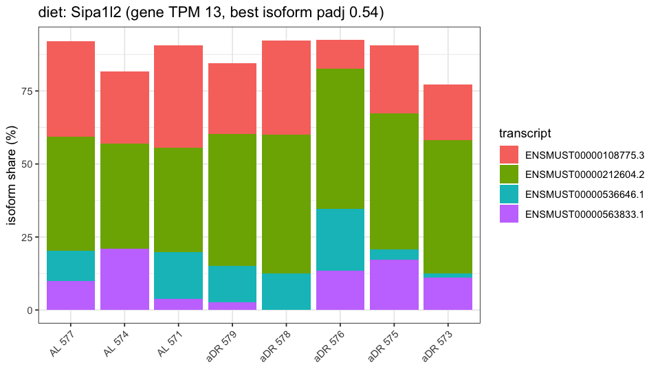
    


    
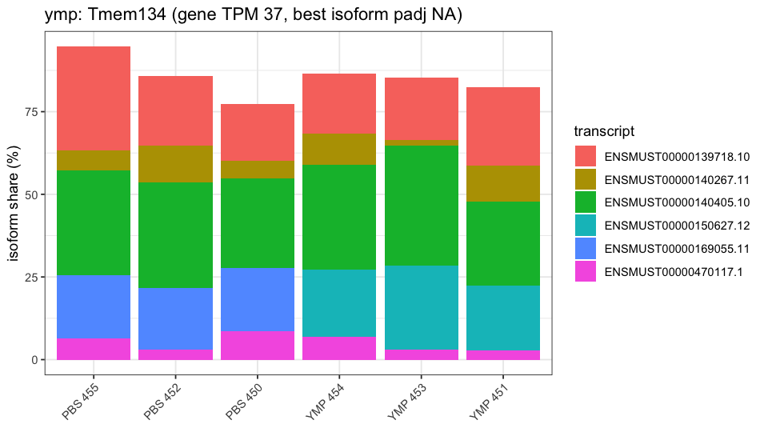
    


```R
# Save the isoform-usage tables
for (n in names(comparisons))
  write.csv(res_dtu[[n]], file.path(out, paste0("isoform_usage_", n, ".csv")), row.names = FALSE)
```
