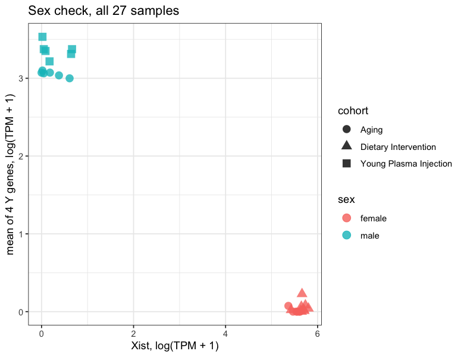
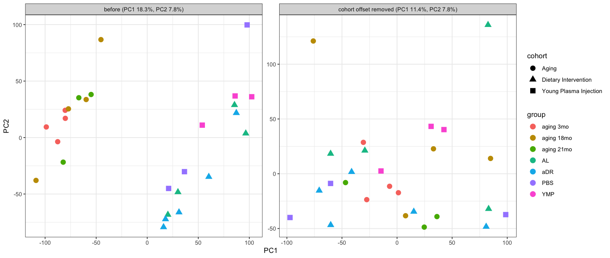
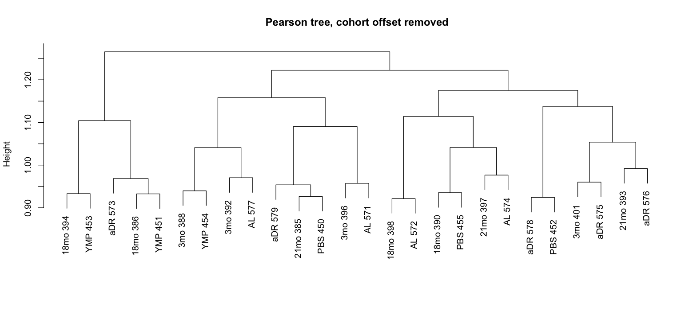
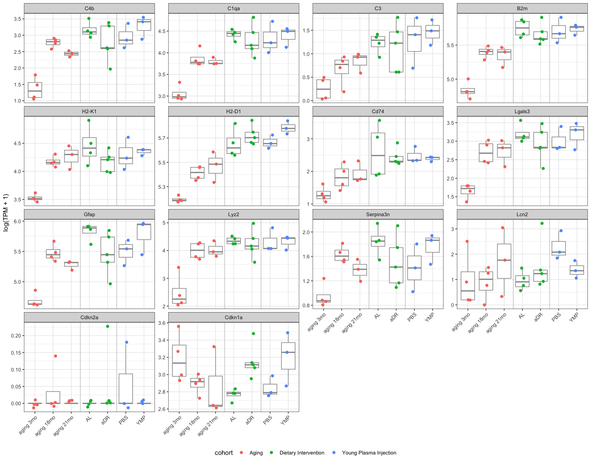
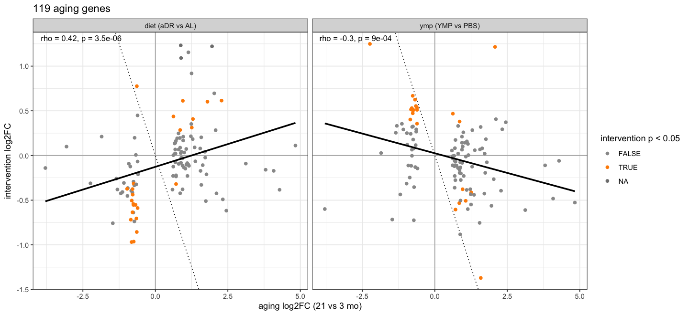
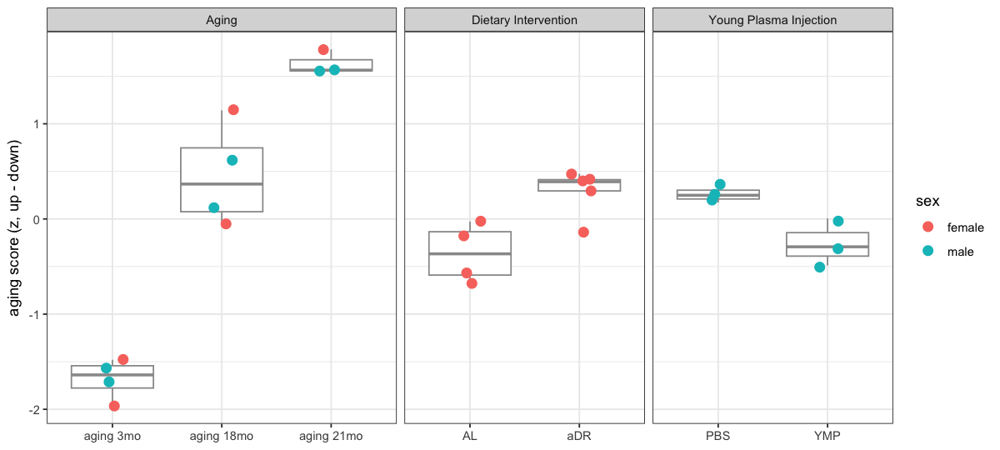
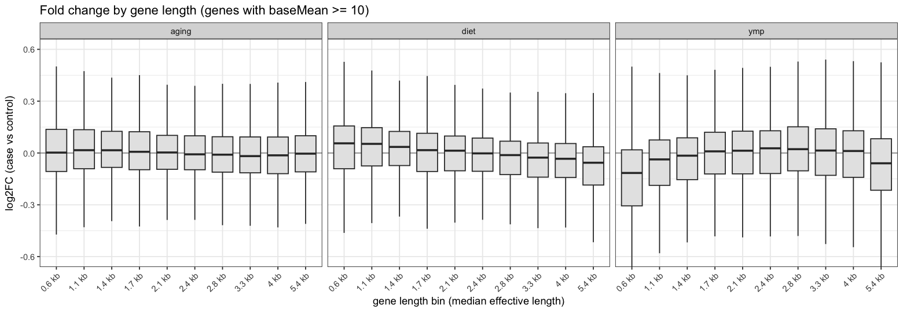
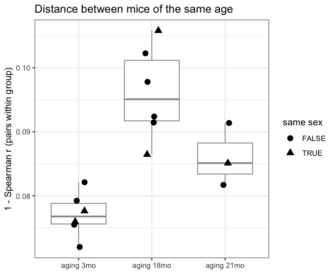
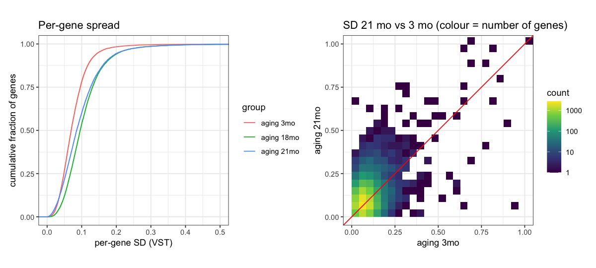
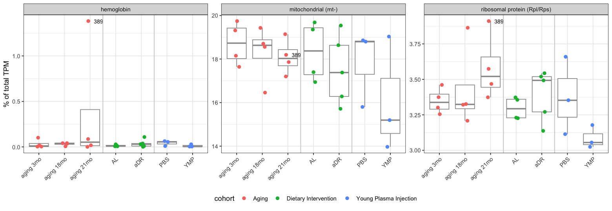

# Part 3, step 3 – extra plots
Further looks at the data that are not in the tutorial:

| Section | Question |
|---|---|
| A | Do the sex labels in `samples.csv` match the expression (Xist vs Y genes)? |
| B | What do all 27 samples look like once the cohort (batch) offset is removed? *Plots only.* |
| C | How do well-known brain-aging genes (complement, MHC, inflammation) behave in every group? |
| D | Do aDR or young plasma move the **aging signature** back towards young? |
| E | Do **long genes** go down with age (a known aging feature)? |
| F | Do old mice differ more from each other than young ones (more variability)? |
| G | Mitochondrial, ribosomal and hemoglobin share of the transcriptome per sample |

SRR21355389 (blood-contaminated) is left out everywhere except A and G. Run each cell with **Shift+Enter**.


```R
options(jupyter.display_mimetypes = c("text/plain", "text/html"))
```

## Setup


```R
library(tidyverse)
library(DESeq2)

options(repr.plot.width = 8, repr.plot.height = 5.5)   # plot size in the notebook
# White plot background (otherwise VS Code dark theme shows through)
setHook("before.plot.new", function() par(bg = "white"))
theme_update(plot.background = element_rect(fill = "white", colour = NA))

base <- "~/Documents/claude/Claude/Systems Genomics/RNAseq_aging/for_teammates"
read_table <- function(f) as.matrix(read.csv(file.path(base, f), row.names = 1, check.names = FALSE))
meta_all <- read.csv(file.path(base, "samples.csv"))
rownames(meta_all) <- meta_all$SRR
expr_all   <- read_table("rsem_tpm.csv.gz")[, meta_all$SRR]              # TPM
counts_all <- read_table("rsem_expected_counts.csv.gz")[, meta_all$SRR]  # estimated reads
efflen     <- read_table("rsem_effective_length.csv.gz")[, meta_all$SRR] # gene length per sample

sym_tab <- read.csv(file.path(base, "genes_M39.csv"))
sym <- setNames(sym_tab$symbol, sym_tab$gene_id)
id_of <- function(symbols) sym_tab$gene_id[match(symbols, sym_tab$symbol)]

# Without the blood-contaminated sample
outlier_blood <- "SRR21355389"
meta   <- meta_all[meta_all$SRR != outlier_blood, ]
expr   <- expr_all[, meta$SRR]
counts <- counts_all[, meta$SRR]

group_order <- c("aging 3mo", "aging 18mo", "aging 21mo", "AL", "aDR", "PBS", "YMP")
expressed_genes <- function(e) rowMeans(e > 0) >= 0.5 | rowMeans(e) >= 1

comparisons <- list(
  aging = list(cohort = "Aging",                  ctrl = "aging 3mo", case = "aging 21mo", covar = "sex"),
  diet  = list(cohort = "Dietary Intervention",   ctrl = "AL",        case = "aDR",        covar = NULL),
  ymp   = list(cohort = "Young Plasma Injection", ctrl = "PBS",       case = "YMP",        covar = NULL)
)
get_samples <- function(cmp) meta[meta$cohort == cmp$cohort & meta$group %in% c(cmp$ctrl, cmp$case), ]
padj_cut <- 0.1
lfc_cut  <- log2(1.5)

table(meta$group)
```


    
           aDR aging 18mo aging 21mo  aging 3mo         AL        PBS        YMP 
             5          4          3          4          4          3          3 


## A. Sex check
*Xist* is only expressed in females; *Ddx3y*, *Eif2s3y*, *Kdm5d* and *Uty* are on the Y chromosome (males only). Every sample should sit clearly on one side; a mismatch with the `sex` column would mean a sample mix-up.


```R
sex_genes <- c("Xist", "Ddx3y", "Eif2s3y", "Kdm5d", "Uty")
sex_expr <- log1p(expr_all[id_of(sex_genes), ])
rownames(sex_expr) <- sex_genes

d <- data.frame(meta_all,
                Xist = sex_expr["Xist", ],
                Y_genes = colMeans(sex_expr[-1, ]))

options(repr.plot.width = 6.5, repr.plot.height = 5)
ggplot(d, aes(Xist, Y_genes, colour = sex, shape = cohort)) +
  geom_point(size = 3.5, alpha = 0.8) +
  labs(x = "Xist, log(TPM + 1)", y = "mean of 4 Y genes, log(TPM + 1)",
       title = "Sex check, all 27 samples") +
  theme_bw()

# Any sample where expression disagrees with the label?
d %>% mutate(predicted = ifelse(Xist > Y_genes, "female", "male")) %>%
  filter(predicted != sex) %>% select(SRR, group, sex, predicted)
```


<table class="dataframe">
<caption>A data.frame: 0 × 4</caption>
<thead>
	<tr><th scope=col>SRR</th><th scope=col>group</th><th scope=col>sex</th><th scope=col>predicted</th></tr>
	<tr><th scope=col>&lt;chr&gt;</th><th scope=col>&lt;chr&gt;</th><th scope=col>&lt;chr&gt;</th><th scope=col>&lt;chr&gt;</th></tr>
</thead>
<tbody>
</tbody>
</table>


    

    


## B. All samples together, cohort offset removed (plots only)
For every gene, the mean log TPM of each cohort is subtracted (the same as `limma::removeBatchEffect` with only a batch factor). This removes the batch effect **and** everything that differs between whole cohorts (sex, age, protocol), so these values must not be used for testing. It only lets us look at the within-cohort structure of all samples in one plot. Because the groups differ only slightly, do not expect them to separate much.


```R
e <- log1p(expr[expressed_genes(expr), ])
e_centered <- e
for (co in unique(meta$cohort)) {
  s <- meta$SRR[meta$cohort == co]
  e_centered[, s] <- e[, s] - rowMeans(e[, s])
}

pca_before <- prcomp(t(e), scale. = TRUE)
pca_after  <- prcomp(t(e_centered[apply(e_centered, 1, var) > 0, ]), scale. = TRUE)
pv <- function(p) round(100 * p$sdev^2 / sum(p$sdev^2), 1)

d <- bind_rows(
  data.frame(pca_before$x[, 1:2], meta, version = paste0("before (PC1 ", pv(pca_before)[1], "%, PC2 ", pv(pca_before)[2], "%)")),
  data.frame(pca_after$x[, 1:2],  meta, version = paste0("cohort offset removed (PC1 ", pv(pca_after)[1], "%, PC2 ", pv(pca_after)[2], "%)"))
) %>% mutate(group = factor(group, levels = group_order))

options(repr.plot.width = 13, repr.plot.height = 5.5)
ggplot(d, aes(PC1, PC2, colour = group, shape = cohort)) +
  geom_point(size = 3.5) +
  facet_wrap(~ version, scales = "free") +
  theme_bw()
```


    

    


```R
# Tree of all 26 samples after removing the cohort offset
lab <- paste(sub("aging ", "", meta$group), substr(meta$SRR, 9, 11))
options(repr.plot.width = 13, repr.plot.height = 6)
plot(hclust(as.dist(1 - cor(e_centered))), labels = lab,
     main = "Pearson tree, cohort offset removed", xlab = "", sub = "")
```


    

    


## C. Known brain-aging genes in every group
Genes reported to rise in the aging brain: complement (*C4b*, *C1qa*, *C3*), antigen presentation (*B2m*, *H2-K1*, *H2-D1*, *Cd74*), microglia/astrocyte activation (*Lgals3*, *Gfap*, *Lyz2*, *Serpina3n*, *Lcn2*) and senescence (*Cdkn2a* = p16, *Cdkn1a* = p21).

All intervention mice are 19 months old, so they should look like 18–21 mo aging mice, but compare groups **within** a panel's cohort only (different experiments).


```R
aging_genes <- c("C4b", "C1qa", "C3", "B2m", "H2-K1", "H2-D1", "Cd74",
                 "Lgals3", "Gfap", "Lyz2", "Serpina3n", "Lcn2", "Cdkn2a", "Cdkn1a")
ids <- id_of(aging_genes)
if (any(is.na(ids))) cat("not found:", aging_genes[is.na(ids)], "\n")

d <- data.frame(meta, t(log1p(expr[ids[!is.na(ids)], ])), check.names = FALSE)
names(d)[(ncol(meta) + 1):ncol(d)] <- aging_genes[!is.na(ids)]
d <- d %>%
  pivot_longer(all_of(aging_genes[!is.na(ids)]), names_to = "gene", values_to = "logTPM") %>%
  mutate(group = factor(group, levels = group_order),
         gene = factor(gene, levels = aging_genes))

options(repr.plot.width = 14, repr.plot.height = 11)
ggplot(d, aes(group, logTPM, colour = cohort)) +
  geom_boxplot(outlier.shape = NA, colour = "grey60") +
  geom_point(size = 1.8, position = position_jitter(width = 0.15, seed = 1)) +
  geom_vline(xintercept = c(3.5, 5.5), colour = "grey80") +
  facet_wrap(~ gene, scales = "free_y", ncol = 4) +
  labs(x = NULL, y = "log(TPM + 1)") +
  theme_bw() +
  theme(axis.text.x = element_text(angle = 45, hjust = 1), legend.position = "bottom")
```


    

    


## D. Do the interventions reverse the aging signature?
1. DESeq2 (Wald test) for each comparison, same samples and covariates as in step 2.
2. Aging genes = 21 mo vs 3 mo with padj < 0.1 and > 1.5-fold.
3. For these genes, plot the aging change against the change with aDR or YMP. Points along the **negative** diagonal mean the intervention pushes the gene back towards young.


```R
run_wald <- function(cmp) {
  m <- get_samples(cmp)
  m$group <- factor(m$group, levels = c(cmp$ctrl, cmp$case))
  design <- if (is.null(cmp$covar)) ~ group else as.formula(paste("~", cmp$covar, "+ group"))
  dds <- suppressMessages(DESeqDataSetFromMatrix(round(counts[, m$SRR]), m, design))
  dds <- dds[rowSums(counts(dds) >= 10) >= 3, ]
  dds <- DESeq(dds, quiet = TRUE)
  results(dds, contrast = c("group", cmp$case, cmp$ctrl)) %>%
    as.data.frame() %>% rownames_to_column("gene") %>%
    mutate(symbol = sym[gene])
}
res <- lapply(comparisons, run_wald)

sapply(res, function(r) c(tested = nrow(r),
                          up   = sum(r$padj < padj_cut & r$log2FoldChange >  lfc_cut, na.rm = TRUE),
                          down = sum(r$padj < padj_cut & r$log2FoldChange < -lfc_cut, na.rm = TRUE)))
```


<table class="dataframe">
<caption>A matrix: 3 × 3 of type int</caption>
<thead>
	<tr><th></th><th scope=col>aging</th><th scope=col>diet</th><th scope=col>ymp</th></tr>
</thead>
<tbody>
	<tr><th scope=row>tested</th><td>16370</td><td>17998</td><td>17619</td></tr>
	<tr><th scope=row>up</th><td>   76</td><td>   22</td><td>   22</td></tr>
	<tr><th scope=row>down</th><td>   43</td><td>   70</td><td>   27</td></tr>
</tbody>
</table>


```R
aging_deg <- res$aging %>% filter(padj < padj_cut, abs(log2FoldChange) > lfc_cut)

d <- bind_rows(lapply(c("diet", "ymp"), function(n) {
  aging_deg %>% select(gene, symbol, aging = log2FoldChange) %>%
    inner_join(res[[n]] %>% select(gene, other = log2FoldChange, other_p = pvalue), by = "gene") %>%
    mutate(comparison = paste0(n, " (", comparisons[[n]]$case, " vs ", comparisons[[n]]$ctrl, ")"))
}))

rho <- d %>% group_by(comparison) %>%
  summarise(n = n(), rho = cor(aging, other, method = "spearman"),
            p = cor.test(aging, other, method = "spearman")$p.value, .groups = "drop")
rho

options(repr.plot.width = 12, repr.plot.height = 5.5)
ggplot(d, aes(aging, other)) +
  geom_hline(yintercept = 0, colour = "grey70") + geom_vline(xintercept = 0, colour = "grey70") +
  geom_abline(slope = -1, linetype = "dotted") +
  geom_point(aes(colour = other_p < 0.05), size = 1.5) +
  geom_smooth(method = "lm", formula = y ~ x, colour = "black", se = FALSE) +
  geom_text(data = rho, aes(x = -Inf, y = Inf, label = paste0("rho = ", round(rho, 2), ", p = ", signif(p, 2))),
            hjust = -0.1, vjust = 1.5, size = 3.5) +
  scale_colour_manual(values = c(`FALSE` = "grey60", `TRUE` = "darkorange"), name = "intervention p < 0.05") +
  facet_wrap(~ comparison) +
  labs(x = "aging log2FC (21 vs 3 mo)", y = "intervention log2FC",
       title = paste(nrow(aging_deg), "aging genes")) +
  theme_bw()
```


<table class="dataframe">
<caption>A tibble: 2 × 4</caption>
<thead>
	<tr><th scope=col>comparison</th><th scope=col>n</th><th scope=col>rho</th><th scope=col>p</th></tr>
	<tr><th scope=col>&lt;chr&gt;</th><th scope=col>&lt;int&gt;</th><th scope=col>&lt;dbl&gt;</th><th scope=col>&lt;dbl&gt;</th></tr>
</thead>
<tbody>
	<tr><td>diet (aDR vs AL)</td><td>118</td><td> 0.4158258</td><td>3.505133e-06</td></tr>
	<tr><td>ymp (YMP vs PBS)</td><td>117</td><td>-0.3040507</td><td>9.044641e-04</td></tr>
</tbody>
</table>


    

    


### Aging score per sample
Score = mean z-score of the aging-**up** genes minus mean z-score of the aging-**down** genes, z-scores computed within each cohort. A high score means an "older-looking" transcriptome.

Note: in the aging cohort the 3 mo and 21 mo samples were used to pick the genes, so their separation is expected (circular). The **18 mo** mice and both intervention cohorts are independent checks.


```R
up   <- aging_deg$gene[aging_deg$log2FoldChange > 0]
down <- aging_deg$gene[aging_deg$log2FoldChange < 0]

score <- unlist(lapply(unique(meta$cohort), function(co) {
  s <- meta$SRR[meta$cohort == co]
  z <- t(scale(t(log1p(expr[c(up, down), s]))))
  z[is.na(z)] <- 0
  colMeans(z[up, , drop = FALSE]) - colMeans(z[down, , drop = FALSE])
}))

d <- data.frame(meta, score = score[meta$SRR]) %>%
  mutate(group = factor(group, levels = group_order))

options(repr.plot.width = 10, repr.plot.height = 4.5)
ggplot(d, aes(group, score, colour = sex)) +
  geom_boxplot(outlier.shape = NA, colour = "grey60") +
  geom_point(size = 3, position = position_jitter(width = 0.12, seed = 1)) +
  facet_grid(~ cohort, scales = "free_x", space = "free_x") +
  labs(x = NULL, y = "aging score (z, up - down)") +
  theme_bw()

# Test within the intervention cohorts
sapply(c("diet", "ymp"), function(n) {
  m <- get_samples(comparisons[[n]])
  t.test(score[m$SRR] ~ m$group)$p.value
})
```


<style>
.dl-inline {width: auto; margin:0; padding: 0}
.dl-inline>dt, .dl-inline>dd {float: none; width: auto; display: inline-block}
.dl-inline>dt::after {content: ":\0020"; padding-right: .5ex}
.dl-inline>dt:not(:first-of-type) {padding-left: .5ex}
</style><dl class=dl-inline><dt>diet</dt><dd>0.0156758437847549</dd><dt>ymp</dt><dd>0.0548534931580138</dd></dl>


    

    


## E. Long genes and aging
Several studies (e.g. Stoeger et al. 2022) found that in old tissue **long genes lose expression** relative to short ones (transcription of long genes is more sensitive to DNA damage). Here: aging log2FC against gene length (median RSEM effective length), in 10 length bins. Diet and YMP for comparison.


```R
gene_len <- apply(efflen, 1, median)

d <- bind_rows(lapply(names(res), function(n)
  res[[n]] %>% filter(baseMean >= 10) %>%
    mutate(comparison = n, length = gene_len[gene]))) %>%
  filter(length > 0) %>%
  group_by(comparison) %>%
  mutate(len_bin = ntile(length, 10)) %>% ungroup()

bin_lab <- d %>% filter(comparison == "aging") %>% group_by(len_bin) %>%
  summarise(lab = paste0(round(median(length) / 1000, 1), " kb"))

d %>% group_by(comparison) %>%
  summarise(rho_length_vs_log2FC = cor(length, log2FoldChange, method = "spearman"),
            p = cor.test(length, log2FoldChange, method = "spearman", exact = FALSE)$p.value)

options(repr.plot.width = 13, repr.plot.height = 4.5)
ggplot(d, aes(factor(len_bin), log2FoldChange)) +
  geom_hline(yintercept = 0, colour = "grey60") +
  geom_boxplot(outlier.shape = NA, fill = "grey90") +
  coord_cartesian(ylim = c(-0.6, 0.6)) +
  scale_x_discrete(labels = bin_lab$lab) +
  facet_wrap(~ comparison) +
  labs(x = "gene length bin (median effective length)", y = "log2FC (case vs control)",
       title = "Fold change by gene length (genes with baseMean >= 10)") +
  theme_bw() +
  theme(axis.text.x = element_text(angle = 45, hjust = 1))
```


<table class="dataframe">
<caption>A tibble: 3 × 3</caption>
<thead>
	<tr><th scope=col>comparison</th><th scope=col>rho_length_vs_log2FC</th><th scope=col>p</th></tr>
	<tr><th scope=col>&lt;chr&gt;</th><th scope=col>&lt;dbl&gt;</th><th scope=col>&lt;dbl&gt;</th></tr>
</thead>
<tbody>
	<tr><td>aging</td><td>-0.05725824</td><td> 6.564476e-13</td></tr>
	<tr><td>diet </td><td>-0.20000413</td><td>7.573562e-151</td></tr>
	<tr><td>ymp  </td><td> 0.08794552</td><td> 8.858706e-31</td></tr>
</tbody>
</table>


    

    


## F. Does variability between mice increase with age?
"Transcriptional noise" is often reported to rise with age. Two views:
- **Pairwise distance**: 1 − Spearman r between every two mice of the same age group.
- **Per-gene spread**: standard deviation of DESeq2 VST values per gene within each age group. To compare fairly, 3 mice per group are used (21 mo has only 3 without 389): all 4 choose 3 subsets of the 3 mo and 18 mo groups are averaged.


```R
aging_s <- meta$SRR[meta$cohort == "Aging"]
e <- expr[, aging_s]
r <- cor(e[expressed_genes(e), ], method = "spearman")
idx <- which(upper.tri(r), arr.ind = TRUE)
g1 <- meta[aging_s[idx[, 1]], "group"]
g2 <- meta[aging_s[idx[, 2]], "group"]
pairs <- data.frame(group = g1, dist = 1 - r[idx], same_sex = meta[aging_s[idx[, 1]], "sex"] == meta[aging_s[idx[, 2]], "sex"])[g1 == g2, ] %>%
  mutate(group = factor(group, levels = group_order[1:3]))

options(repr.plot.width = 5.5, repr.plot.height = 4.5)
ggplot(pairs, aes(group, dist)) +
  geom_boxplot(outlier.shape = NA, colour = "grey60") +
  geom_point(aes(shape = same_sex), size = 3, position = position_jitter(width = 0.1, seed = 1)) +
  labs(x = NULL, y = "1 - Spearman r (pairs within group)", shape = "same sex",
       title = "Distance between mice of the same age") +
  theme_bw()
```


    

    


```R
m <- meta[aging_s, ]
dds <- suppressMessages(DESeqDataSetFromMatrix(round(counts[, aging_s]), m, design = ~ 1))
dds <- dds[rowSums(counts(dds) >= 10) >= 3, ]
v <- assay(vst(dds, blind = TRUE))

gene_sd <- sapply(group_order[1:3], function(g) {
  s <- m$SRR[m$group == g]
  subsets <- combn(s, 3, simplify = FALSE)
  rowMeans(sapply(subsets, function(ss) apply(v[, ss], 1, sd)))
})
apply(gene_sd, 2, median)   # median per-gene SD per age group

d <- data.frame(gene_sd, check.names = FALSE) %>%
  pivot_longer(everything(), names_to = "group", values_to = "sd") %>%
  mutate(group = factor(group, levels = group_order[1:3]))

options(repr.plot.width = 10, repr.plot.height = 4.5)
p1 <- ggplot(d, aes(sd, colour = group)) +
  stat_ecdf() +
  coord_cartesian(xlim = c(0, 0.5)) +
  labs(x = "per-gene SD (VST)", y = "cumulative fraction of genes", title = "Per-gene spread") +
  theme_bw()
p2 <- ggplot(data.frame(gene_sd, check.names = FALSE), aes(`aging 3mo`, `aging 21mo`)) +
  geom_bin_2d(bins = 60) + geom_abline(colour = "red") +
  scale_fill_viridis_c(trans = "log10") +
  coord_equal(xlim = c(0, 1), ylim = c(0, 1)) +
  labs(title = "SD 21 mo vs 3 mo (colour = number of genes)") +
  theme_bw()
patchwork::wrap_plots(p1, p2)

# Paired test: is the per-gene SD higher at 21 mo than at 3 mo?
# (median of the paired differences and p-value)
c(median_diff = median(gene_sd[, "aging 21mo"] - gene_sd[, "aging 3mo"]),
  p = wilcox.test(gene_sd[, "aging 21mo"], gene_sd[, "aging 3mo"], paired = TRUE)$p.value)
```


<style>
.dl-inline {width: auto; margin:0; padding: 0}
.dl-inline>dt, .dl-inline>dd {float: none; width: auto; display: inline-block}
.dl-inline>dt::after {content: ":\0020"; padding-right: .5ex}
.dl-inline>dt:not(:first-of-type) {padding-left: .5ex}
</style><dl class=dl-inline><dt>aging 3mo</dt><dd>0.0695954426360925</dd><dt>aging 18mo</dt><dd>0.0956758932209983</dd><dt>aging 21mo</dt><dd>0.0854262400188535</dd></dl>


<style>
.dl-inline {width: auto; margin:0; padding: 0}
.dl-inline>dt, .dl-inline>dd {float: none; width: auto; display: inline-block}
.dl-inline>dt::after {content: ":\0020"; padding-right: .5ex}
.dl-inline>dt:not(:first-of-type) {padding-left: .5ex}
</style><dl class=dl-inline><dt>median_diff</dt><dd>0.0159731477562091</dd><dt>p</dt><dd>0</dd></dl>


    

    


## G. Mitochondrial, ribosomal and hemoglobin share per sample
Share of all TPM coming from mitochondrially encoded genes (*mt-*), ribosomal protein genes (*Rpl*/*Rps*) and hemoglobins. Mitochondrial transcription is often reported to drop with age; hemoglobin flags blood (SRR21355389 is included here and labelled).


```R
gene_class <- case_when(
  grepl("^mt-", sym[rownames(expr_all)])                 ~ "mitochondrial (mt-)",
  grepl("^Rp[ls][0-9]+[a-z]?$", sym[rownames(expr_all)]) ~ "ribosomal protein (Rpl/Rps)",
  grepl("^Hb[ab]-", sym[rownames(expr_all)])             ~ "hemoglobin",
  TRUE ~ NA_character_)
table(gene_class)

share <- sapply(c("mitochondrial (mt-)", "ribosomal protein (Rpl/Rps)", "hemoglobin"), function(cl)
  100 * colSums(expr_all[which(gene_class == cl), ]) / colSums(expr_all))

d <- data.frame(meta_all, share, check.names = FALSE) %>%
  pivot_longer(colnames(share), names_to = "class", values_to = "pct") %>%
  mutate(group = factor(group, levels = group_order))

options(repr.plot.width = 13, repr.plot.height = 4.5)
ggplot(d, aes(group, pct, colour = cohort)) +
  geom_boxplot(outlier.shape = NA, colour = "grey60") +
  geom_point(size = 2, position = position_jitter(width = 0.12, seed = 1)) +
  geom_text(data = subset(d, SRR == outlier_blood), aes(label = "389"),
            colour = "black", size = 3, hjust = -0.4, show.legend = FALSE) +
  geom_vline(xintercept = c(3.5, 5.5), colour = "grey80") +
  facet_wrap(~ class, scales = "free_y") +
  labs(x = NULL, y = "% of total TPM") +
  theme_bw() +
  theme(axis.text.x = element_text(angle = 45, hjust = 1), legend.position = "bottom")
```


    gene_class
                     hemoglobin         mitochondrial (mt-) 
                             12                          37 
    ribosomal protein (Rpl/Rps) 
                             79 


    

    

